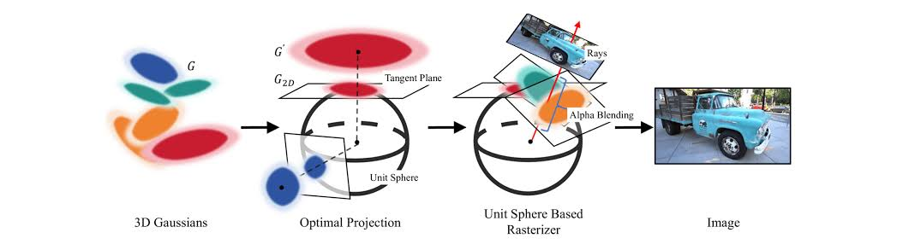
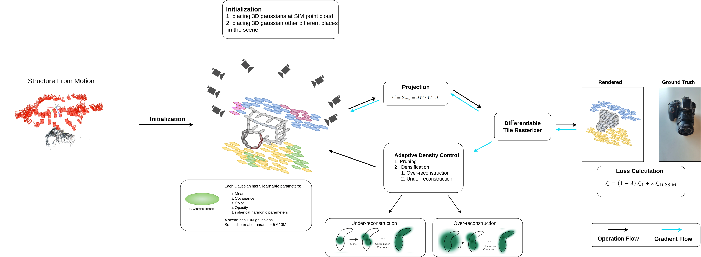
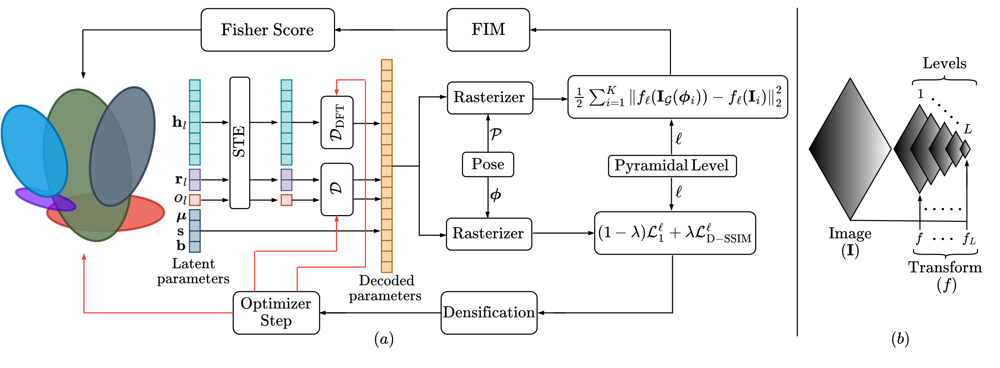
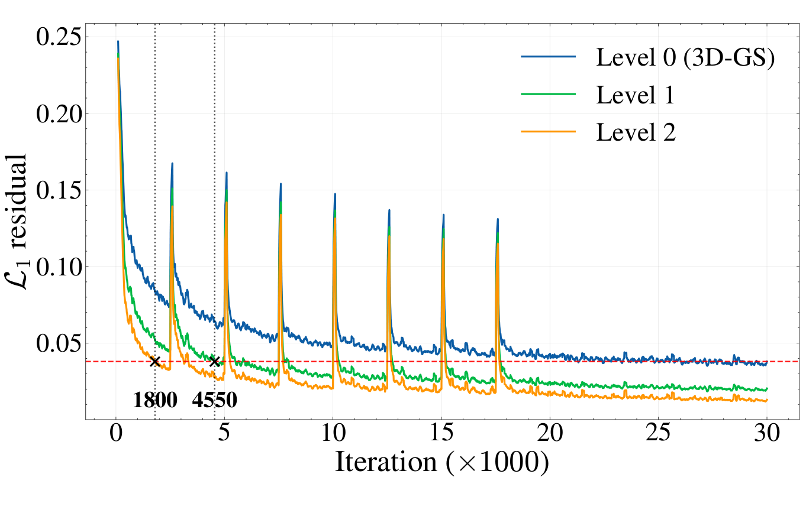
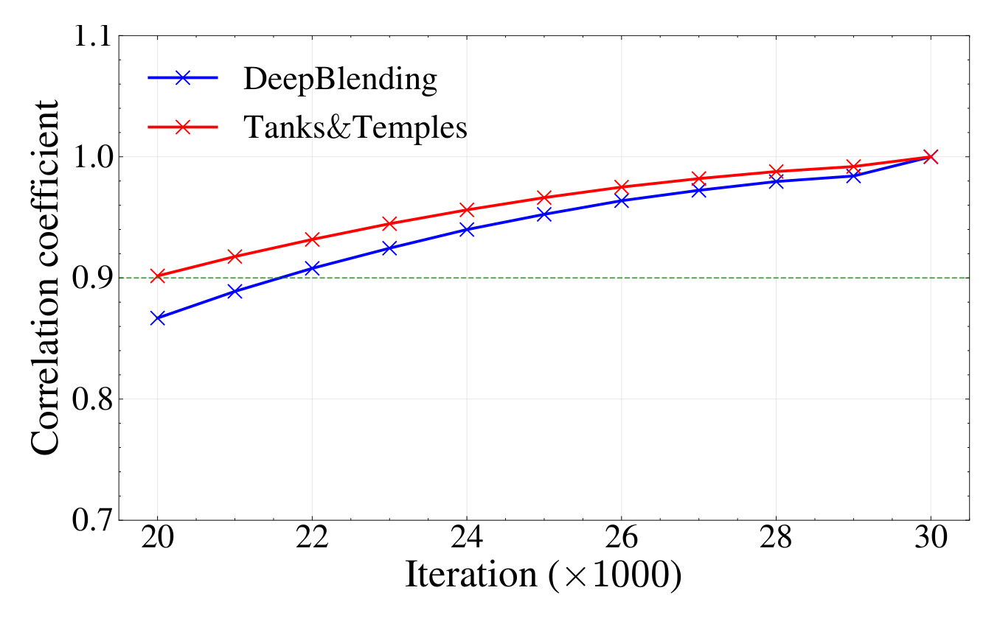
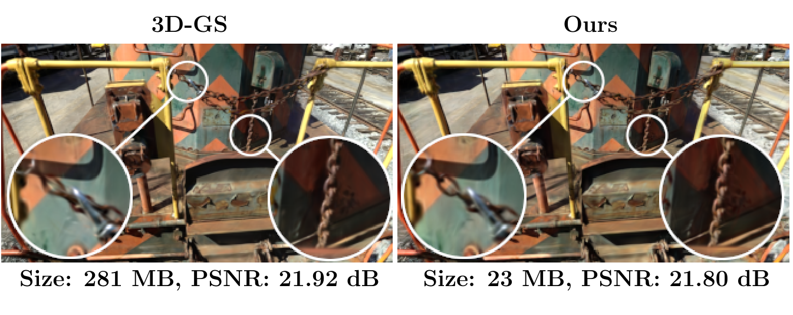

##  {.hero-slide}

:::::::: title-hero
::: eyebrow
IPD434 · Soft Computing · Análisis de artículo
:::

::: hero-paper
Making Fisher Work:\
Train-Time Compression for 3D Gaussian Splatting
:::

::: hero-authors
P G Arun Madhav · Chandra Sekhar Seelamantula
:::

::: hero-meta
Department of Electrical Engineering, Indian Institute of Science, Bangalore

IEEE International Conference on Image Processing (ICIP), 2026 · DOI: 10.1109/ICIP61757.2026.11630029
:::

::: hero-presenter
Presenta: **Francisco Alfaro Medina** · Universidad Técnica Federico Santa María
:::
::::::::

::: notes
**⏱ 0:25 · acumulado 0:25**

Presento «Making Fisher Work», de Arun Madhav y Seelamantula, del Indian Institute of Science, publicado en IEEE ICIP 2026. El artículo propone comprimir 3D Gaussian Splatting durante el entrenamiento, no solo al final. La exposición gira en torno a una sola figura: el diagrama del método.
:::

## 3D-GS ocupa demasiado: el objetivo es comprimir al entrenar

::: eyebrow
Problema y objetivo
:::

:::::: problem-text
::: fragment
[Problema]{.kicker}

Una escena puede requerir **millones de gaussianas**, con **59 parámetros** cada una. Los armónicos esféricos concentran más del **80 %** del almacenamiento.
:::

::: fragment
[Brecha]{.kicker}

La poda y la cuantización suelen llegar **después del entrenamiento**, cuando la redundancia ya se acumuló.
:::

::: fragment
[Objetivo del artículo]{.kicker}

Guiar la compresión **mientras se optimiza**: poda sensible a Fisher y cuantización CAQ durante el entrenamiento.
:::
::::::

::: {.image-frame .problem-illustration}
{fig-alt="Flujo de 3D Gaussian Splatting: gaussianas 3D, proyección óptima, rasterizador basado en esfera unitaria y la imagen renderizada."}
:::

::: notes
**⏱ 0:50 · acumulado 1:15**

3D Gaussian Splatting representa la escena con millones de gaussianas; la animación recorre los términos de una de ellas: centro, covarianza, opacidad y punto evaluado. Cada gaussiana guarda 59 valores, y según el artículo los armónicos esféricos superan el 80 % del almacenamiento, de modo que el tamaño es el producto entre el número de primitivas y los bytes por primitiva. Los métodos previos usan poda heurística o cuantización genérica, que no evitan que la redundancia se acumule. El objetivo del artículo es controlar cómo emerge esa redundancia durante el entrenamiento, para comprimir mientras se optimiza.
:::

## El pipeline de 3D-GS optimiza, densifica y poda

::: eyebrow
Conceptos previos · Pipeline de 3D-GS
:::

```{=html}
<div class="image-frame pipeline-frame">
<figure class="fig-full fig-pipeline">
  
  <svg viewBox="0 0 2000 735" aria-hidden="true">
    <rect class="ring fragment" data-fragment-index="0" x="1086" y="400" width="244" height="160" rx="26"/>
  </svg>
</figure>
</div>
<div class="points"><p class="fragment" data-fragment-index="0">La poda se hará en la parte remarcada: <strong>Adaptive Density Control</strong>.</p></div>
```

::: notes
**⏱ 0:50 · acumulado 2:05**

El pipeline de 3D-GS parte de una nube de puntos de Structure from Motion, inicializa las gaussianas, las proyecta y rasteriza, y compara el render con la imagen real. El bloque remarcado, el control adaptativo de densidad, agrega y elimina gaussianas, y en esa parte se hará la poda. A continuación paso al lazo del artículo.
:::

## Todo ocurre en un único lazo de entrenamiento

::: eyebrow
El lazo del artículo · Fig. 2
:::

```{=html}
<figure class="fig-full">
  
  <svg viewBox="0 0 2000 738" aria-hidden="true">
    <g class="fragment" data-fragment-index="0">
      <path class="ring" d="M1605 100H1995V700H1605Z"/>
      <circle class="badge" cx="1640" cy="135" r="28"/><text class="badge-n" x="1640" y="149">1</text>
    </g>
    <g class="fragment" data-fragment-index="1">
      <path class="ring" d="M385 3H1592V245H880V112H385Z"/>
      <circle class="badge" cx="1550" cy="45" r="28"/><text class="badge-n" x="1550" y="59">2</text>
    </g>
    <g class="fragment" data-fragment-index="2">
      <path class="ring" d="M335 112H860V660H650V678H305V505H335Z"/>
      <circle class="badge" cx="825" cy="145" r="28"/><text class="badge-n" x="825" y="159">3</text>
    </g>
  </svg>
</figure>
<div class="image-caption">Fuente: artículo, Fig. 2.</div>
<div class="parts">
  <p class="fragment" data-fragment-index="0"><b>1</b><strong>Pirámide:</strong> de grueso a fino</p>
  <p class="fragment" data-fragment-index="1"><b>2</b><strong>Fisher:</strong> poda al entrenar</p>
  <p class="fragment" data-fragment-index="2"><b>3</b><strong>CAQ:</strong> cuantización por correlación</p>
</div>
```

::: notes
**⏱ 1:00 · acumulado 3:05**

PUP, el método de origen, solo puede podar cerca de la convergencia. Las dos contribuciones del artículo quedan en este único lazo. La pirámide regula cuándo entra el detalle de la imagen (zona 1), lo que hace fiable el puntaje de Fisher para podar primitivas (zona 2). De forma complementaria, la cuantización CAQ reduce lo que guarda cada primitiva (zona 3).
:::

## De grueso a fino: residual bajo muy temprano {.has-map}

::: eyebrow
Paso 1 · Pirámide · Fig. 2(b) y Fig. 3
:::

```{=html}
<div class="fig2-map" aria-hidden="true">
  
  <svg viewBox="0 0 2000 738"><path class="dim" d="M0 0H2000V738H0Z M1605 100H1995V700H1605Z"/><path class="ring" d="M1605 100H1995V700H1605Z"/></svg>
</div>
```

::::: fig-row
```{=html}
<div class="crop-col">
<figure class="fig2-crop z-pyramid pyramid-crop">
  
</figure>
<div class="image-caption">Fuente: artículo, Fig. 2(b).</div>
</div>
```

:::: {.image-frame .fig3-frame}
{fig-alt="Residual L1 por iteración para los niveles 0, 1 y 2. Los marcadores indican el primer cruce bajo el residual del 3D-GS convergido: iteración 1.800 y 4.550."}

::: image-caption
Tanks&Temples; línea roja: 3D-GS convergido. Fuente: artículo, Fig. 3.
:::
::::
:::::

::::: {.points .points-row}
::: fragment
Se entrena primero con imágenes **suavizadas y reducidas**; el detalle fino entra después.
:::

::: fragment
Los niveles 2 y 1 bajan del residual de un 3D-GS convergido en las iteraciones **1.800** y **4.550**.
:::
:::::

::: notes
**⏱ 1:20 · acumulado 4:25**

El 3D-GS estándar supervisa con todo el espectro desde el inicio, lo que dificulta la optimización temprana. La pirámide del panel (b) aplica suavizado gaussiano y reducción a la mitad, y el entrenamiento avanza del nivel más grueso al más fino, con transiciones en las iteraciones 5.000 y 10.000. En la Fig. 3, sobre Tanks&Temples, la línea roja es el residual de un 3D-GS convergido: el nivel 2 la cruza en la iteración 1.800 y el nivel 1 en la 4.550. Ese régimen de residual bajo es la condición que necesita el paso siguiente.
:::

## Con residual bajo, el Hessiano da un puntaje por gaussiana {.has-map}

::: eyebrow
Paso 2 · Fisher y poda · Fig. 2(a) y Fig. 4
:::

```{=html}
<div class="fig2-map" aria-hidden="true">
  
  <svg viewBox="0 0 2000 738"><path class="dim" d="M0 0H2000V738H0Z M385 3H1592V245H880V112H385Z"/><path class="ring" d="M385 3H1592V245H880V112H385Z"/></svg>
</div>
<figure class="fig2-crop z-fisher">
  
  <div class="crop-note fragment" data-fragment-index="2">Poda cada 3.000 iteraciones, entre la 21.000 y la 27.000.</div>
  <div class="crop-src">Fuente: artículo, Fig. 2(a).</div>
</figure>
```

:::::::: fisher-row
::::: equation-card
::: {.fragment fragment-index="0"}
[Fisher: cuánto cambia la imagen al perturbar los parámetros]{.eq-label}

$$\nabla^2_{\mathcal{G}}\mathcal{L}_2 \approx \sum_{i=1}^{K} \mathbf{J}_{f_{\scriptstyle\ell}}\nabla_{\mathcal{G}}\mathbf{I}_{\mathcal{G}}(\boldsymbol{\phi}_i)\,\nabla_{\mathcal{G}}\mathbf{I}_{\mathcal{G}}(\boldsymbol{\phi}_i)^{\top}\mathbf{J}_{f_{\scriptstyle\ell}}^{\top}$$
:::

::: {.fragment fragment-index="1"}
[Bloque de cada gaussiana → puntaje]{.eq-label}

$$U_j = \log|\mathbf{H}_j|$$

$U_j$ bajo: la gaussiana se considera **redundante** y se poda.
:::
:::::

:::: {.image-frame .fig4-frame}
{fig-alt="Correlación de Spearman entre los rankings de sensibilidad y los de un 3D-GS convergido, de la iteración 20.000 a la 30.000, para Deep Blending y Tanks&Temples."}

::: image-caption
Spearman. Fuente: artículo, Fig. 4.
:::
::::
::::::::

::: notes
**⏱ 2:00 · acumulado 6:25**

Al derivar dos veces el error L2 medido en el nivel ele aparecen dos términos: uno con gradientes y otro multiplicado por el residual, que con residual bajo es empíricamente despreciable. Queda la aproximación de Fisher, que mide cuánto cambia la imagen al perturbar los parámetros; se toma el bloque de cada gaussiana, su log-determinante da el puntaje U, y las gaussianas con puntaje bajo se consideran redundantes y se podan. Hay dos regímenes: la poda piramidal, intercalada con los niveles, evita que la redundancia de la etapa gruesa sesgue el ajuste fino, y la poda iterativa ocurre cada 3.000 iteraciones entre la 21.000 y la 27.000. La Fig. 4 la justifica: en las últimas etapas, el ranking de sensibilidad mantiene una alta correlación de Spearman con el de un 3D-GS convergido.
:::

## CAQ cuantiza cada grupo según su correlación {.has-map}

::: eyebrow
Paso 3 · Cuantización · Fig. 2(a)
:::

```{=html}
<div class="fig2-map" aria-hidden="true">
  
  <svg viewBox="0 0 2000 738"><path class="dim" d="M0 0H2000V738H0Z M335 112H860V660H650V678H305V505H335Z"/><path class="ring" d="M335 112H860V660H650V678H305V505H335Z"/></svg>
</div>
```

:::::::: caq-row
```{=html}
<div class="crop-col">
<figure class="fig2-crop z-caq caq-crop">
  
</figure>
<div class="image-caption">Fuente: artículo, Fig. 2(a).</div>
</div>
```

::::::: {.points .points-stack}
::: fragment
**Rotación y opacidad** ($\mathbf{r}_\ell, o_\ell$): decorrelacionadas \[5\]. Latentes escalares y decodificador lineal $\mathcal{D}$.
:::

::: fragment
**Armónicos esféricos** ($\mathbf{h}_\ell$): fuerte correlación entre canales \[16\]. Decodificador basado en DFT, $\mathcal{D}_{\text{DFT}}$ \[17\].
:::

:::: fragment
**STE** \[18\]: discretiza hacia adelante y conserva el gradiente hacia atrás.

::: equation-card
$$\mathbf{h} = \mathcal{D}_{\text{DFT}}\big(\operatorname{STE}(\mathbf{h}_\ell)\big), \quad \mathbf{r}, o = \mathcal{D}\big(\operatorname{STE}(\mathbf{r}_\ell, o_\ell)\big)$$
:::
::::
:::::::
::::::::

::: notes
**⏱ 1:15 · acumulado 7:40**

El tercer paso reduce lo que guarda cada primitiva, con una estrategia según la correlación de cada grupo de parámetros, en lugar de un esquema genérico. Rotación y opacidad están decorrelacionadas y usan latentes escalares con un decodificador lineal compacto, mientras que los armónicos presentan fuerte correlación entre canales y usan un decodificador basado en la DFT. El STE discretiza en el paso hacia adelante y conserva el gradiente hacia atrás, lo que permite optimizar latentes y decodificadores junto con el 3D-GS. Al terminar, los latentes se discretizan, se codifican por entropía y se guardan con sus decodificadores.
:::

## ≈95 % menos almacenamiento que 3D-GS, con calidad competitiva

::: eyebrow
Resultados · Tablas 1 y 2 del artículo
:::

```{=html}
<table class="table-roomy" aria-label="Extracto de la Tabla 1 del artículo: PSNR y tamaño por método y dataset">
<thead>
<tr><th rowspan="2">Método</th><th colspan="2" class="group-start">Mip-NeRF 360 [19]</th><th colspan="2" class="group-start">Tanks&amp;Temples [20]</th><th colspan="2" class="group-start">Deep Blending [21]</th></tr>
<tr><th class="group-start">PSNR↑</th><th>MB↓</th><th class="group-start">PSNR↑</th><th>MB↓</th><th class="group-start">PSNR↑</th><th>MB↓</th></tr>
</thead>
<tbody>
<tr class="baseline"><td>3D-GS [1]</td><td class="group-start">27,44</td><td>822,6</td><td class="group-start">23,67</td><td>452,4</td><td class="group-start">29,48</td><td>692,5</td></tr>
<tr><td>Compact [4]</td><td class="group-start">26,95</td><td class="best">26,31</td><td class="group-start">23,33</td><td class="best">18,97</td><td class="group-start">29,71</td><td class="best">25,75</td></tr>
<tr><td>EAGLES [5]</td><td class="group-start best">27,07</td><td>59,49</td><td class="group-start">23,14</td><td>30,18</td><td class="group-start">29,72</td><td>54,45</td></tr>
<tr><td>LightGaussian [6]</td><td class="group-start">26,90</td><td>53,96</td><td class="group-start">23,32</td><td>29,94</td><td class="group-start">29,12</td><td>45,25</td></tr>
<tr><td>PUP [7]</td><td class="group-start">26,67</td><td>74,65</td><td class="group-start">22,72</td><td>43,37</td><td class="group-start">28,85</td><td>69,98</td></tr>
<tr class="ours"><td>Propuesto</td><td class="group-start">27,01</td><td>32,78</td><td class="group-start best">23,38</td><td>23,93</td><td class="group-start best">29,87</td><td>30,07</td></tr>
</tbody>
</table>
<div class="table-legend"><span><i class="best"></i>Mejor de la columna, según el artículo; 3D-GS queda fuera del ranking.</span></div>
```

::::: result-foot
::: {.result-stat .fragment}
[≈95 %]{.stat-value}

[menos que 3D-GS (promedio)]{.stat-label}
:::

::: fragment
**Ablación en *bonsai*:** CAQ reduce los bytes por primitiva (294,55 → 44,22 MB); PPT y las podas reducen las primitivas (0,98 → 0,33 M).
:::
:::::

::: notes
**⏱ 1:15 · acumulado 8:55**

La Tabla 1 compara el método en tres benchmarks reales, y el artículo informa una reducción promedio de 95 % frente a 3D-GS. Compact es el más pequeño en los tres datasets y el método propuesto queda segundo; en PSNR, el propuesto lidera en Tanks&Temples y Deep Blending, y EAGLES lidera en Mip-NeRF 360. La ablación en la escena bonsai separa los efectos: CAQ baja de 294,55 a 44,22 MB, y la pirámide y las podas llevan las primitivas de 0,98 a 0,33 M. El modelo final alcanza 30,92 dB frente a 32,25 dB de 3D-GS, con 15,28 MB frente a 294,55 MB.
:::

## Conclusión: la poda basada en Fisher ya funciona durante el entrenamiento

::: eyebrow
Conclusión y preguntas
:::

:::::: closing-points
::: fragment
[Aporta]{.kicker}

Poda basada en Fisher **en tiempo de entrenamiento**.
:::

::: fragment
[Logra]{.kicker}

**≈95 %** menos almacenamiento que 3D-GS.
:::

::: fragment
[Extensión de los autores]{.kicker}

Cronogramas adaptativos y otras estrategias de cuantización.
:::
::::::

:::: closing-row

::: .center
```{=html}
<div class="crop-col">
<figure class="fig-full"></figure>
<div class="image-caption">Escena <em>train</em>, Tanks&amp;Temples. Fuente: artículo, Fig. 1.</div>
</div> 
```
:::


::::

::: notes
**⏱ 0:40 · acumulado 9:35**

En síntesis, el artículo lleva la poda basada en Fisher al tiempo de entrenamiento mediante la supervisión piramidal, y la combina con una cuantización según la correlación, con cerca de 95 % menos almacenamiento que 3D-GS; la figura lo ilustra en la escena train, de 281 a 23 MB, con 21,92 y 21,80 dB. Los autores declaran una limitación: suponen que la supervisión gruesa deja residuales suficientemente pequeños. Proponen como extensión cronogramas de supervisión adaptativos y otras estrategias de cuantización. Muchas gracias; quedo a disposición para sus preguntas.

**Preguntas probables (según el artículo)**

**¿Por qué no se podía usar Fisher antes?** La aproximación del Hessiano solo es fiable con residual despreciable, y por eso PUP se aplica cerca de la convergencia.

**¿Cuál es el modelo más pequeño?** Compact, en los tres datasets; el método propuesto queda segundo en tamaño (Tabla 1).

**¿Qué pasa si los niveles gruesos no dejan residual bajo?** Es la limitación que declaran los autores; el artículo no evalúa ese caso.

**¿Qué tasas de poda, FPS o tiempos de entrenamiento obtiene?** No figuran en este PDF: el artículo remite a su material suplementario (Sec. 8.1).
:::


## Referencias {visibility="uncounted"}

::: eyebrow
Respaldo · Numeración del artículo
:::

::: references
**Artículo.** P. G. Arun Madhav y C. S. Seelamantula, «Making Fisher Work: Train-Time Compression for 3D Gaussian Splatting», IEEE ICIP, 2026.

**\[1\]** Kerbl et al., «3D Gaussian Splatting for Real-Time Radiance Field Rendering», *ACM TOG*, 2023.

**\[4\]** Lee et al., «Compact 3D Gaussian Representation for Radiance Field», arXiv:2311.13681, 2023.

**\[5\]** Girish et al., «EAGLES», ECCV, 2024.

**\[6\]** Fan et al., «LightGaussian», NeurIPS, 2024.

**\[7\]** Hanson et al., «PUP 3D-GS», arXiv:2406.10219, 2024.

**\[16\]** Seeley, «Spherical Harmonics», *Amer. Math. Monthly*, 1966.

**\[17\]** Moczulski et al., «ACDC: A Structured Efficient Linear Layer», 2016.

**\[18\]** Huh et al., «Straightening Out the Straight-Through Estimator», ICML, 2023.

**\[19\]** Barron et al., «Mip-NeRF 360», CVPR, 2022.

**\[20\]** Knapitsch et al., «Tanks and Temples», *ACM TOG*, 2017.

**\[21\]** Hedman et al., «Deep Blending for Free-Viewpoint Image-Based Rendering», *ACM TOG*, 2018.
:::

::: notes
Respaldo: no se presenta salvo que pidan una referencia. La numeración es la del artículo.
:::

##  {.hero-slide}

:::::::: title-hero
::: eyebrow
IPD434 · Soft Computing · Análisis de artículo
:::

::: hero-paper
Making Fisher Work:\
Train-Time Compression for 3D Gaussian Splatting
:::

::: hero-authors
P G Arun Madhav · Chandra Sekhar Seelamantula
:::

::: hero-meta
Department of Electrical Engineering, Indian Institute of Science, Bangalore

IEEE International Conference on Image Processing (ICIP), 2026 · DOI: 10.1109/ICIP61757.2026.11630029
:::

::: hero-presenter
Presenta: **Francisco Alfaro Medina** · Universidad Técnica Federico Santa María
:::
::::::::
