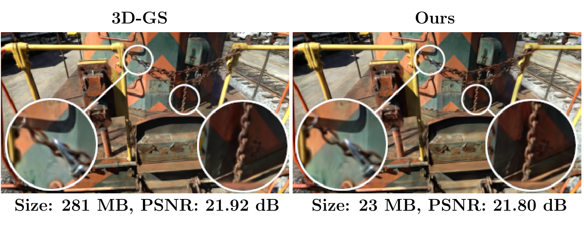
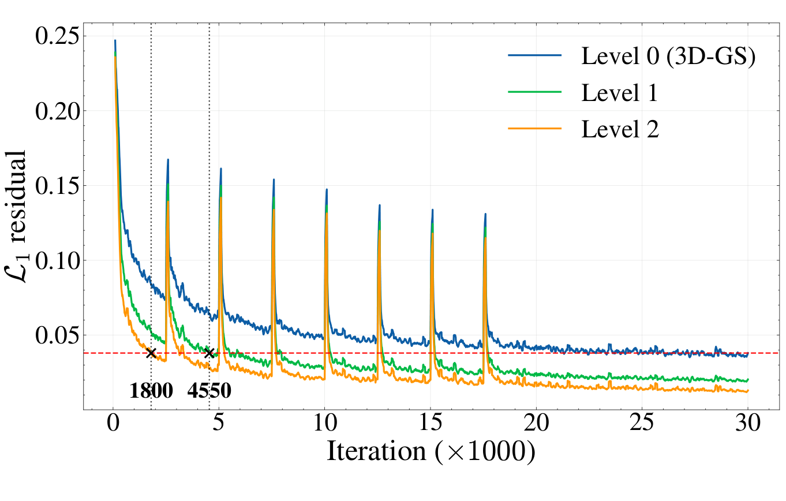
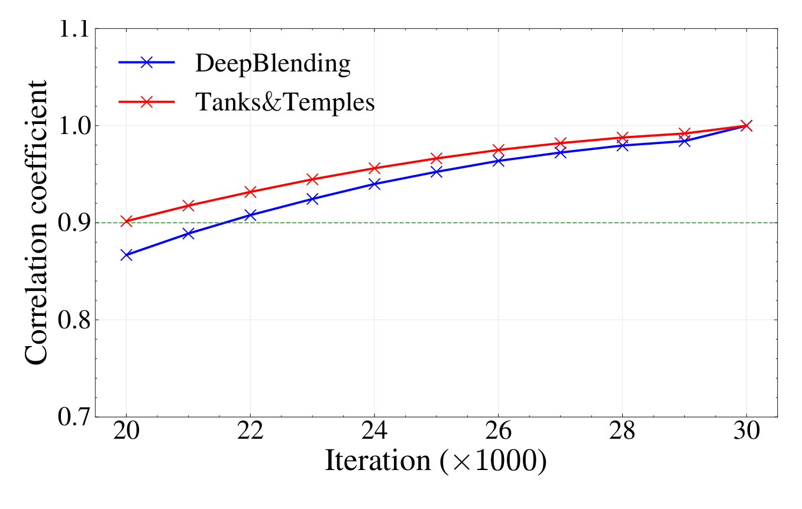
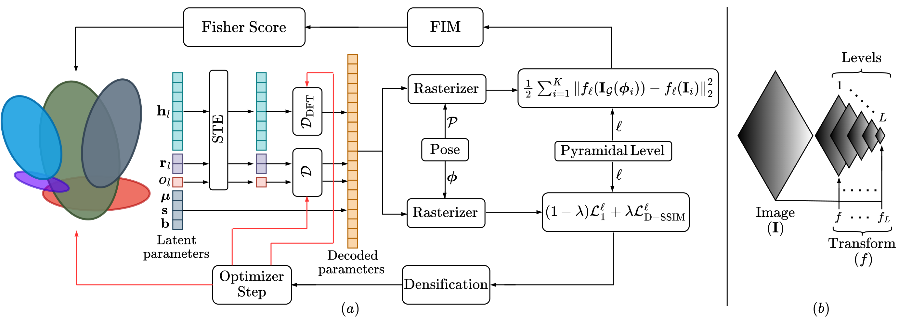

##  {.hero-slide}

:::::::: {.title-hero .hero-solo}
::: eyebrow
INF479 · Seminario de Softcomputing · Análisis de artículo
:::

::: hero-paper
Making Fisher Work:\
Train-Time Compression for 3D Gaussian Splatting
:::

::: hero-authors
P G Arun Madhav · Chandra Sekhar Seelamantula
:::

::: hero-meta
Department of Electrical Engineering, Indian Institute of Science, Bangalore

IEEE International Conference on Image Processing (ICIP), 2026 · DOI: 10.1109/ICIP61757.2026.11630029
:::

::: hero-presenter
Presenta: **Francisco Alfaro Medina** , Universidad Técnica Federico Santa María
:::
::::::::

::: notes
**⏱ 0:25 · acumulado 0:25** · Pauta: identificación del artículo.

Presento el análisis de «Making Fisher Work», de Arun Madhav y Seelamantula, del Indian Institute of Science, publicado en IEEE ICIP 2026. Sostengo que su aporte central no es un cuantizador más eficiente, sino una decisión sobre cuándo comprimir. Recorreré el problema, el método, la evidencia y una evaluación crítica.
:::

## 3D-GS logra tiempo real a costa de cientos de MB de almacenamiento

::: eyebrow
Contexto y problema
:::

::::::::: columns
::::: {.column width="60%"}
:::: {.image-frame .frame-problem}
{fig-alt="Misma vista de la escena train con 3D-GS (281 MB, 21,92 dB) y con el método propuesto (23 MB, 21,80 dB); los acercamientos muestran la cadena."}

::: image-caption
Escena *train*, Tanks&Temples (Fig. 1 del artículo).
:::
::::
:::::

::::: {.column width="40%"}
::: {.step-card .neutral}
[Escala]{.card-title}

Una reconstrucción de calidad suele requerir **millones de primitivas** \[1\].
:::

::: {.step-card .orange .stack}
[Presupuesto]{.card-title}

Cada gaussiana guarda **59 valores**. Según el artículo, los armónicos esféricos superan el **80 %**.
:::
:::::
:::::::::

::: key-line
Tamaño = **número de primitivas** × **bytes por primitiva**: la compresión debe actuar sobre ambos factores.
:::

::: notes
**⏱ 1:05 · acumulado 1:30** · Pauta: contexto y problema. Detalle de los parámetros en la lámina de respaldo.

3D Gaussian Splatting representa una escena mediante primitivas gaussianas y logra síntesis de vistas nuevas en tiempo real. Su limitación es de escala: una reconstrucción de calidad suele requerir millones de primitivas, con un consumo elevado de memoria y almacenamiento. En la Tabla 1 del artículo, 3D-GS ocupa entre 452 y 823 megabytes según el dataset. Conviene expresar el tamaño como un producto: número de primitivas por bytes por primitiva. Cada gaussiana guarda 59 valores y, según el artículo, los armónicos esféricos superan el 80 % del almacenamiento. La figura ilustra el resultado en la escena train: de 281 a 23 megabytes, con una pérdida de 0,12 decibeles, y los acercamientos conservan el detalle de la cadena. Es un único ejemplo; la evidencia general viene después.

**Transición:** veamos por qué los enfoques existentes no resolvían este problema.

*Si preguntan por el 92,24 %:* la figura muestra tamaños redondeados (281 y 23 MB), que dan 91,8 %, y el artículo no publica los valores sin redondear. No lo presento como un error. Eso sí, redondear a MB enteros solo explica hasta cerca de 92,0 %, así que con el PDF no puedo reconstruir la cifra exacta.
:::

## La compresión previa no regula cuándo emerge la redundancia

::: eyebrow
Brecha, objetivo y contribuciones
:::

:::::: grid-3
::: {.step-card .neutral .compact}
[Entrenamiento progresivo]{.card-title}

Estabiliza, pero no busca regular la redundancia \[5, 11\].
:::

::: {.step-card .neutral .compact}
[Poda]{.card-title}

PUP \[7\] deriva un puntaje del Hessiano, aplicable solo cerca de converger.
:::

::: {.step-card .neutral .compact}
[Cuantización]{.card-title}

La mayoría aplica esquemas genéricos a parámetros heterogéneos.
:::
::::::

::: key-line
**Objetivo:** controlar cómo emerge la redundancia durante el entrenamiento, con dos contribuciones (C1 y C2).
:::

```{=html}
<div class="chain chain-compact">
  <div class="chain-node"><strong>C1 · Pirámide (PPT)</strong><span>Supervisión de grueso a fino.</span></div>
  <div class="chain-arrow" aria-hidden="true">→</div>
  <div class="chain-node"><strong>Residual bajo</strong><span>Temprano, en niveles gruesos.</span></div>
  <div class="chain-arrow" aria-hidden="true">→</div>
  <div class="chain-node"><strong>Fisher utilizable</strong><span>Aproximación del Hessiano.</span></div>
  <div class="chain-arrow" aria-hidden="true">→</div>
  <div class="chain-node lever"><strong>Poda en entrenamiento</strong><span>Menos <b>primitivas</b>.</span></div>
</div>
<div class="chain-lower chain-compact">
  <div class="chain-node"><strong>C2 · Correlación</strong><span>Distinta en cada grupo.</span></div>
  <div class="chain-arrow" aria-hidden="true">→</div>
  <div class="chain-node lever"><strong>Cuantización (CAQ)</strong><span>Menos <b>bytes por primitiva</b>.</span></div>
  <div class="chain-arrow" aria-hidden="true">→</div>
  <div class="chain-result"><strong>≈95 % menos de almacenamiento</strong><span>Promedio informado frente a 3D-GS.</span></div>
</div>
```

::: notes
**⏱ 1:20 · acumulado 2:50** · Pauta: calidad y contribución del artículo; comprensión técnica. El lazo completo (Fig. 2) está en respaldo.

El artículo organiza la literatura en tres líneas. El entrenamiento progresivo mejora la estabilidad, pero no está diseñado para regular la redundancia. En poda, PUP deriva un puntaje del Hessiano de la pérdida L2, aplicable solo cerca de la convergencia. En cuantización, la mayoría aplica esquemas genéricos a parámetros heterogéneos. Esta caracterización es de los autores. El objetivo es entonces controlar cómo emerge la redundancia durante el entrenamiento, y el artículo declara dos contribuciones. La primera es una cadena: la supervisión piramidal reduce tempranamente el residual; con residual bajo, la aproximación de Fisher se vuelve utilizable, y eso permite podar durante el entrenamiento, reduciendo el número de primitivas. La segunda es independiente de Fisher: una cuantización que aprovecha la correlación de cada grupo y reduce los bytes por primitiva. Ambos factores se multiplican. En mi lectura, lo original no es el puntaje, heredado de PUP, sino crear las condiciones para usarlo antes de converger. Si el residual no baja, el resto de la cadena pierde respaldo.

**Transición:** examino cada eslabón, comenzando por la pirámide.
:::

## La supervisión piramidal adelanta el régimen de residual bajo

::: eyebrow
Metodología · Paso 1 · Entrenamiento piramidal progresivo
:::

```{=html}
<div class="timeline" role="img" aria-label="Cronograma: nivel 2 hasta la iteración 5.000, nivel 1 hasta la 10.000 y nivel 0 desde entonces">
  <span class="l2">Nivel 2</span>
  <span class="l1">Nivel 1</span>
  <span class="l0">Nivel 0: resolución completa (desde la iteración 10.000)</span>
</div>
```

:::::::::::: {.columns .after-strip}
::::: {.column width="58%"}
:::: {.image-frame .frame-residual}
{fig-alt="Residual L1 por iteración para los niveles 0, 1 y 2. Los marcadores indican el primer cruce bajo el residual del 3D-GS convergido: iteración 1.800 en el nivel 2 y 4.550 en el nivel 1."}

::: image-caption
Tanks&Temples. Línea roja: 3D-GS convergido (Fig. 3).
:::
::::
:::::

:::::::: {.column width="42%"}
::::: stat-row
::: stat-tile
[1.800]{.stat-value} [primer cruce, nivel 2]{.stat-label}
:::

::: stat-tile
[4.550]{.stat-value} [primer cruce, nivel 1]{.stat-label}
:::
:::::

::: {.equation-card .eq-sm}
$$L^\ell = (1-\lambda)L_1^\ell + \lambda L_{\text{D-SSIM}}^\ell$$

$f$: suavizado gaussiano y reducción a la mitad; $f_\ell$: $f$ aplicada $\ell$ veces.
:::

::: note-card
La causa de los picos visibles no figura en el PDF.
:::
::::::::
::::::::::::

::: notes
**⏱ 1:15 · acumulado 4:05** · Pauta: comprensión técnica.

El 3D-GS estándar supervisa con todo el espectro desde la iteración cero, lo que exige explicar altas frecuencias cuando la optimización es menos estable y el paisaje de pérdida es complejo. La propuesta define una transformación f, que aplica suavizado gaussiano y reduce la resolución a la mitad, y la compone ele veces. Hay tres niveles: el más grueso hasta la iteración 5.000, el intermedio hasta la 10.000 y luego resolución completa. La pérdida conserva su forma; cambia la imagen contra la que se mide. La figura muestra el efecto. La línea roja es el residual de un 3D-GS convergido. El nivel 2 la cruza por primera vez en la iteración 1.800, y el nivel 1 en la 4.550. Una condición que en PUP exige acercarse a la convergencia aparece aquí muy temprano. Dos cautelas: se trata de un primer cruce, y se muestra solo en Tanks and Temples.

**Transición:** veamos por qué ese residual es la condición matemática relevante.

*Si preguntan por los picos:* se ven en la figura, pero su causa no figura en el PDF, así que no la atribuyo.

*Si preguntan por el cronograma:* la figura dibuja los tres niveles durante todas las iteraciones, y el texto no detalla cómo se obtuvo cada curva.
:::

## Un residual bajo reduce el Hessiano a un puntaje por gaussiana

::: eyebrow
Metodología · Paso 2 · Sensibilidad basada en Fisher
:::

::: {.equation-card .eq-md}
$$\nabla_G^2 L_2 = \sum_{i=1}^{K}\Big[\underbrace{J_{f_{\scriptstyle\ell}}\nabla_G I_G(\phi_i)\,\nabla_G I_G(\phi_i)^{\top} J_{f_{\scriptstyle\ell}}^{\top}}_{\text{se conserva: aproximación de Fisher}} + \underbrace{\big(f_\ell(I_G(\phi_i)) - f_\ell(I_i)\big)\nabla_G^2 f_\ell(I_G(\phi_i))}_{\text{depende del residual: empíricamente despreciable}}\Big]$$
:::

::::: grid-2
::: {.equation-card .eq-md}
**Un bloque por gaussiana**

$$H_j = \sum_{i=1}^{K} J_{f_{\scriptstyle\ell}}\nabla_{G_{\scriptstyle j}} I_G(\phi_i)\,\nabla_{G_{\scriptstyle j}} I_G(\phi_i)^{\top} J_{f_{\scriptstyle\ell}}^{\top}$$
:::

::: {.equation-card .eq-md}
**Un número por gaussiana**

$$U_j = \log |H_j|$$
:::
:::::

::: key-line
$U_j$ alto: **se conserva**. $U_j$ bajo: se considera redundante y **se poda**.
:::

::: notes
**⏱ 1:30 · acumulado 5:35** · Pauta: comprensión técnica; es el núcleo del método. No apurar.

Se parte del error L2 medido en el nivel ele, es decir, entre el render y la imagen real después de aplicar la pirámide. Al derivar dos veces con la regla de la cadena aparecen dos términos. El primero solo contiene gradientes y el jacobiano de la pirámide. El segundo está multiplicado por el residual. Con residual bajo, los autores lo consideran empíricamente despreciable, y queda la aproximación de Fisher. Es una condición empírica: el artículo no acota el término despreciado. La aproximación resultante mide cuánto responden las imágenes a una perturbación de los parámetros. Para que el cálculo sea tratable se toma solo el bloque diagonal de cada gaussiana, lo que ignora las interacciones entre gaussianas distintas. El log-determinante convierte ese bloque en un escalar, el puntaje U. Un puntaje alto indica que las imágenes son sensibles a esa gaussiana; uno bajo, que se considera redundante. Respecto de PUP, lo nuevo es el jacobiano de la pirámide y, sobre todo, el momento en que se aplica. La forma de la ecuación 6 corresponde a una aproximación de tipo Gauss-Newton; esa denominación es mía, no del artículo.

**Transición:** con ese puntaje, ¿cuándo se poda?

*Si preguntan por qué log-determinante (lectura propia):* el determinante mide el volumen de sensibilidad en todas las direcciones de parámetros y el logaritmo lo lleva a una escala ordenable. El artículo solo lo define como medida escalar de contribución.
:::

## Un mismo puntaje sustenta dos regímenes de poda

::: eyebrow
Metodología · Paso 2 · Poda
:::

::::::::: columns
::::: {.column width="45%"}
::: step-card
[Poda piramidal]{.card-title}

Se intercala con los niveles. Evita que la redundancia de la etapa gruesa **sesgue el ajuste fino**.
:::

::: {.step-card .orange .stack}
[Poda iterativa]{.card-title}

Cada **3.000 iteraciones**, entre la **21.000** y la **27.000**, cuando los rankings ya son estables.
:::
:::::

::::: {.column width="55%"}
:::: {.image-frame .frame-spearman}
{fig-alt="Correlación de Spearman entre 0,87 y 1,0 para Deep Blending y entre 0,90 y 1,0 para Tanks&Temples, de la iteración 20.000 a la 30.000."}

::: image-caption
Spearman frente a un 3D-GS convergido (Fig. 4).
:::
::::
:::::
:::::::::

::: key-line
Esta figura comienza en la iteración 20.000: **no cubre las etapas gruesas**.
:::

::: notes
**⏱ 1:10 · acumulado 6:45** · Pauta: comprensión técnica.

El puntaje se usa en dos regímenes. La poda piramidal se intercala con los niveles y elimina redundancia formada bajo supervisión gruesa, para que no sesgue el ajuste fino. Los autores la presentan como regularización, no como compresión final. La poda iterativa ocurre cada 3.000 iteraciones entre la 21.000 y la 27.000, un cronograma que los autores describen como empíricamente equilibrado. Se justifica con esta figura: desde la iteración 20.000, los rankings de sensibilidad se aproximan a los del modelo convergido; a simple vista, Tanks and Temples parte cerca de 0,90 y Deep Blending cerca de 0,87. La correlación de rangos es la métrica adecuada porque la poda depende del orden, no del valor absoluto. La figura no cubre las etapas gruesas; retomo este punto en la evaluación crítica.

**Transición:** esto actúa sobre el número de primitivas. Falta el costo de cada una.

*Si preguntan por las tasas o las iteraciones de la poda piramidal:* no figuran en este PDF; el artículo remite a un material suplementario (Sec. 8.1) que no forma parte de él.
:::

## CAQ adapta la cuantización a la correlación de cada grupo

::: eyebrow
Metodología · Paso 3 · Cuantización consciente de la correlación
:::

::::: grid-2
::: {.step-card .neutral}
[Rotación $r$ y opacidad $o$]{.card-title}

**Decorrelacionados** \[5\]: bastan latentes escalares y un decodificador lineal compacto.
:::

::: {.step-card .orange}
[Armónicos esféricos $h$]{.card-title}

**Fuerte correlación entre canales** \[16\]: un decodificador basado en DFT \[17\] los lleva a una base de frecuencia.
:::
:::::

::: {.equation-card .eq-lg}
$$h = \mathcal{D}_{\text{DFT}}\big(\operatorname{STE}(h_\ell)\big), \qquad r, o = \mathcal{D}\big(\operatorname{STE}(r_\ell, o_\ell)\big)$$
:::

::::: grid-2
::: accent-card
**Durante el entrenamiento**

El STE \[18\] discretiza hacia adelante y conserva el gradiente hacia atrás.
:::

::: accent-card
**Después del entrenamiento**

Los latentes se discretizan, se codifican por entropía y se guardan con sus decodificadores.
:::
:::::

::: notes
**⏱ 1:05 · acumulado 7:50** · Pauta: comprensión técnica.

El tercer paso reduce los bytes por primitiva. La cuantización genérica trata igual a parámetros con estructuras de correlación distintas. Aquí, rotación y opacidad se consideran decorrelacionadas, de modo que bastan latentes escalares y un decodificador lineal compacto. Los armónicos muestran fuerte correlación entre canales, y un decodificador basado en la transformada de Fourier discreta los lleva a una base de frecuencia. Como dominan el presupuesto, tiene sentido darles un decodificador propio. La cuantización es una operación escalonada, con gradiente nulo casi en todas partes; el estimador straight-through discretiza en el paso hacia adelante y conserva el flujo de gradiente hacia atrás. Así, latentes y decodificadores se optimizan conjuntamente con el 3D-GS. Al terminar el entrenamiento, los latentes se discretizan, se codifican por entropía y se almacenan con sus decodificadores.

**Transición:** paso a la evidencia experimental.

*Si preguntan por qué DFT y no una base aprendida:* el artículo la justifica por la correlación entre canales, pero no compara alternativas; «otras estrategias de cuantización» queda como trabajo futuro.
:::

## ≈95 % menos que 3D-GS, aunque Compact obtiene modelos menores

::: eyebrow
Resultados · Calidad frente a tamaño [lectura propia]{.own-tag}
:::

```{=html}
<figure class="chart-frame" style="margin:0"><svg viewBox="0 0 1448 392" role="img" aria-label="PSNR frente a tamaño para cinco compresores en tres datasets. Compact es siempre el más pequeño y el método propuesto queda segundo en tamaño. Valores en la Tabla 1."><text class="panel-title" x="66" y="30">Mip-NeRF 360 · −96,0 %</text><line x1="66" x2="466" y1="330.0" y2="330.0" stroke="#E4EAF0" stroke-width="1"/><text class="axis-text" x="57" y="338.0" text-anchor="end">26,4</text><line x1="66" x2="466" y1="243.8" y2="243.8" stroke="#E4EAF0" stroke-width="1"/><text class="axis-text" x="57" y="251.8" text-anchor="end">26,8</text><line x1="66" x2="466" y1="157.7" y2="157.7" stroke="#E4EAF0" stroke-width="1"/><text class="axis-text" x="57" y="165.7" text-anchor="end">27,2</text><line x1="66" x2="466" y1="71.5" y2="71.5" stroke="#E4EAF0" stroke-width="1"/><text class="axis-text" x="57" y="79.5" text-anchor="end">27,6</text><text class="axis-text" x="66.0" y="359" text-anchor="middle">0</text><text class="axis-text" x="166.0" y="359" text-anchor="middle">20</text><text class="axis-text" x="266.0" y="359" text-anchor="middle">40</text><text class="axis-text" x="366.0" y="359" text-anchor="middle">60</text><text class="axis-text" x="466.0" y="359" text-anchor="middle">80</text><text class="axis-text" x="466" y="388" text-anchor="end">tamaño (MB)</text><line x1="66" x2="466" y1="330" y2="330" stroke="#C7D2DC" stroke-width="1"/><line x1="66" x2="466" y1="106.0" y2="106.0" stroke="#55667C" stroke-width="1.5" stroke-dasharray="6 5"/><text class="ref-label" x="466" y="99.0" text-anchor="end">3D-GS: 27,44 dB · 822,6 MB</text><g><title>EAGLES: 59,49 MB, 27,07 dB</title><circle cx="363.4" cy="185.7" r="14" fill="transparent"/><circle cx="363.4" cy="185.7" r="7" fill="#8496A8" stroke="#fff" stroke-width="2"/></g><text class="point-label" x="363.4" y="170.7" text-anchor="middle">EAGLES</text><g><title>LightGaussian: 53,96 MB, 26,90 dB</title><circle cx="335.8" cy="222.3" r="14" fill="transparent"/><circle cx="335.8" cy="222.3" r="7" fill="#8496A8" stroke="#fff" stroke-width="2"/></g><text class="point-label" x="367.8" y="253.3" text-anchor="middle">LightGaussian</text><g><title>PUP: 74,65 MB, 26,67 dB</title><circle cx="439.3" cy="271.8" r="14" fill="transparent"/><circle cx="439.3" cy="271.8" r="7" fill="#8496A8" stroke="#fff" stroke-width="2"/></g><text class="point-label" x="425.3" y="279.8" text-anchor="end">PUP</text><g><title>Compact: 26,31 MB, 26,95 dB</title><circle cx="197.5" cy="211.5" r="14" fill="transparent"/><circle cx="197.5" cy="211.5" r="9" fill="#00908F" stroke="#fff" stroke-width="2"/></g><text class="point-label strong" x="189.5" y="242.5" text-anchor="middle">Compact</text><g><title>Propuesto: 32,78 MB, 27,01 dB</title><circle cx="229.9" cy="198.6" r="14" fill="transparent"/><circle cx="229.9" cy="198.6" r="9" fill="#D9731A" stroke="#fff" stroke-width="2"/></g><text class="point-label strong" x="229.9" y="183.6" text-anchor="middle">Propuesto</text><text class="panel-title" x="550" y="30">Tanks&amp;Temples · −94,7 %</text><line x1="550" x2="950" y1="330.0" y2="330.0" stroke="#E4EAF0" stroke-width="1"/><text class="axis-text" x="541" y="338.0" text-anchor="end">22,6</text><line x1="550" x2="950" y1="243.8" y2="243.8" stroke="#E4EAF0" stroke-width="1"/><text class="axis-text" x="541" y="251.8" text-anchor="end">23,0</text><line x1="550" x2="950" y1="157.7" y2="157.7" stroke="#E4EAF0" stroke-width="1"/><text class="axis-text" x="541" y="165.7" text-anchor="end">23,4</text><line x1="550" x2="950" y1="71.5" y2="71.5" stroke="#E4EAF0" stroke-width="1"/><text class="axis-text" x="541" y="79.5" text-anchor="end">23,8</text><text class="axis-text" x="550.0" y="359" text-anchor="middle">0</text><text class="axis-text" x="650.0" y="359" text-anchor="middle">20</text><text class="axis-text" x="750.0" y="359" text-anchor="middle">40</text><text class="axis-text" x="850.0" y="359" text-anchor="middle">60</text><text class="axis-text" x="950.0" y="359" text-anchor="middle">80</text><text class="axis-text" x="950" y="388" text-anchor="end">tamaño (MB)</text><line x1="550" x2="950" y1="330" y2="330" stroke="#C7D2DC" stroke-width="1"/><line x1="550" x2="950" y1="99.5" y2="99.5" stroke="#55667C" stroke-width="1.5" stroke-dasharray="6 5"/><text class="ref-label" x="950" y="92.5" text-anchor="end">3D-GS: 23,67 dB · 452,4 MB</text><g><title>EAGLES: 30,18 MB, 23,14 dB</title><circle cx="700.9" cy="213.7" r="14" fill="transparent"/><circle cx="700.9" cy="213.7" r="7" fill="#8496A8" stroke="#fff" stroke-width="2"/></g><text class="point-label" x="714.9" y="221.7" text-anchor="start">EAGLES</text><g><title>LightGaussian: 29,94 MB, 23,32 dB</title><circle cx="699.7" cy="174.9" r="14" fill="transparent"/><circle cx="699.7" cy="174.9" r="7" fill="#8496A8" stroke="#fff" stroke-width="2"/></g><text class="point-label" x="713.7" y="182.9" text-anchor="start">LightGaussian</text><g><title>PUP: 43,37 MB, 22,72 dB</title><circle cx="766.9" cy="304.2" r="14" fill="transparent"/><circle cx="766.9" cy="304.2" r="7" fill="#8496A8" stroke="#fff" stroke-width="2"/></g><text class="point-label" x="780.9" y="312.2" text-anchor="start">PUP</text><g><title>Compact: 18,97 MB, 23,33 dB</title><circle cx="644.9" cy="172.8" r="14" fill="transparent"/><circle cx="644.9" cy="172.8" r="9" fill="#00908F" stroke="#fff" stroke-width="2"/></g><text class="point-label strong" x="630.9" y="203.8" text-anchor="middle">Compact</text><g><title>Propuesto: 23,93 MB, 23,38 dB</title><circle cx="669.6" cy="162.0" r="14" fill="transparent"/><circle cx="669.6" cy="162.0" r="9" fill="#D9731A" stroke="#fff" stroke-width="2"/></g><text class="point-label strong" x="669.6" y="147.0" text-anchor="middle">Propuesto</text><text class="panel-title" x="1034" y="30">Deep Blending · −95,7 %</text><line x1="1034" x2="1434" y1="319.2" y2="319.2" stroke="#E4EAF0" stroke-width="1"/><text class="axis-text" x="1025" y="327.2" text-anchor="end">28,8</text><line x1="1034" x2="1434" y1="233.1" y2="233.1" stroke="#E4EAF0" stroke-width="1"/><text class="axis-text" x="1025" y="241.1" text-anchor="end">29,2</text><line x1="1034" x2="1434" y1="146.9" y2="146.9" stroke="#E4EAF0" stroke-width="1"/><text class="axis-text" x="1025" y="154.9" text-anchor="end">29,6</text><line x1="1034" x2="1434" y1="60.8" y2="60.8" stroke="#E4EAF0" stroke-width="1"/><text class="axis-text" x="1025" y="68.8" text-anchor="end">30,0</text><text class="axis-text" x="1034.0" y="359" text-anchor="middle">0</text><text class="axis-text" x="1134.0" y="359" text-anchor="middle">20</text><text class="axis-text" x="1234.0" y="359" text-anchor="middle">40</text><text class="axis-text" x="1334.0" y="359" text-anchor="middle">60</text><text class="axis-text" x="1434.0" y="359" text-anchor="middle">80</text><text class="axis-text" x="1434" y="388" text-anchor="end">tamaño (MB)</text><line x1="1034" x2="1434" y1="330" y2="330" stroke="#C7D2DC" stroke-width="1"/><line x1="1034" x2="1434" y1="172.8" y2="172.8" stroke="#55667C" stroke-width="1.5" stroke-dasharray="6 5"/><text class="ref-label" x="1434" y="165.8" text-anchor="end">3D-GS: 29,48 dB · 692,5 MB</text><g><title>EAGLES: 54,45 MB, 29,72 dB</title><circle cx="1306.2" cy="121.1" r="14" fill="transparent"/><circle cx="1306.2" cy="121.1" r="7" fill="#8496A8" stroke="#fff" stroke-width="2"/></g><text class="point-label" x="1320.2" y="129.1" text-anchor="start">EAGLES</text><g><title>LightGaussian: 45,25 MB, 29,12 dB</title><circle cx="1260.2" cy="250.3" r="14" fill="transparent"/><circle cx="1260.2" cy="250.3" r="7" fill="#8496A8" stroke="#fff" stroke-width="2"/></g><text class="point-label" x="1274.2" y="258.3" text-anchor="start">LightGaussian</text><g><title>PUP: 69,98 MB, 28,85 dB</title><circle cx="1383.9" cy="308.5" r="14" fill="transparent"/><circle cx="1383.9" cy="308.5" r="7" fill="#8496A8" stroke="#fff" stroke-width="2"/></g><text class="point-label" x="1369.9" y="316.5" text-anchor="end">PUP</text><g><title>Compact: 25,75 MB, 29,71 dB</title><circle cx="1162.8" cy="123.2" r="14" fill="transparent"/><circle cx="1162.8" cy="123.2" r="9" fill="#00908F" stroke="#fff" stroke-width="2"/></g><text class="point-label strong" x="1148.8" y="131.2" text-anchor="end">Compact</text><g><title>Propuesto: 30,07 MB, 29,87 dB</title><circle cx="1184.3" cy="88.8" r="14" fill="transparent"/><circle cx="1184.3" cy="88.8" r="9" fill="#D9731A" stroke="#fff" stroke-width="2"/></g><text class="point-label strong" x="1198.3" y="96.8" text-anchor="start">Propuesto</text></svg><div class="chart-key"><span><i style="background:#D9731A"></i>Propuesto</span><span><i style="background:#00908F"></i>Compact</span><span><i style="background:#8496A8"></i>Otros</span><span>Vertical: PSNR (dB) · Mejor: arriba a la izquierda · −x %: frente a 3D-GS · Datos: Tabla 1</span></div></figure>
```

:::::: grid-3
::: {.step-card .orange}
[Frente a Compact]{.card-title}

Pesa **17–26 % más** y gana **de 0,05 a 0,16 dB**.
:::

::: {.step-card .navy}
[Frente a PUP]{.card-title}

**1,8–2,3 veces** más pequeño y **de 0,34 a 1,02 dB** mejor.
:::

::: {.step-card .neutral}
[Frente a 3D-GS]{.card-title}

Pierde **0,43** y **0,29 dB** en dos datasets; gana **0,39 dB** en otro.
:::
::::::

::: notes
**⏱ 1:15 · acumulado 9:05** · Pauta: resultados y análisis crítico. Tabla 1 completa en respaldo. El gráfico y los porcentajes son elaboración propia con datos de la Tabla 1.

Se evalúan tres benchmarks reales. Frente a 3D-GS, la reducción es de 96, 95 y 96 por ciento, coherente con el 95 declarado. Pero esa comparación es poco exigente; lo informativo es la calidad por megabyte entre compresores. Cada panel muestra PSNR frente a tamaño, y la región óptima está arriba a la izquierda. Compact es el más pequeño en los tres datasets. En los tres paneles, el método propuesto queda arriba y a la derecha de Compact: pesa entre 17 y 26 % más y gana entre 0,05 y 0,16 decibeles. Es un compromiso; ninguno domina al otro. La ventaja más clara está en Deep Blending, donde además supera a 3D-GS en PSNR y SSIM. Frente a PUP, su método de origen, la mejora es clara, aunque mezcla poda en entrenamiento y cuantización. Además, EAGLES lidera el PSNR en Mip-NeRF por 0,06 decibeles, y 3D-GS sigue por encima en dos datasets.

**Transición:** para separar esos efectos, el artículo presenta una ablación.

*Datos finos:* en el ranking del artículo, el propuesto marca mejor en 8 de 9 métricas de calidad, con empates en SSIM 0,801 y LPIPS 0,202. En Deep Blending frente a 3D-GS mejora PSNR y SSIM, pero no LPIPS (0,248 frente a 0,246).
:::

## CAQ reduce los bytes por primitiva; PPT y la poda, las primitivas

::: eyebrow
Resultados · Ablación en una sola escena (bonsai) [lectura propia]{.own-tag}
:::

:::::::: {.columns .top}
::: {.column width="60%"}
```{=html}
<table class="table-lg" aria-label="Extracto de la Tabla 2 del artículo, con bytes por primitiva calculados">
<thead><tr><th>Configuración</th><th>PSNR</th><th>LPIPS</th><th>Primitivas</th><th>MB</th><th>≈B/prim.</th></tr></thead>
<tbody>
<tr class="baseline"><td>3D-GS</td><td>32,25</td><td>0,181</td><td>1,25 M</td><td>294,55</td><td>≈236</td></tr>
<tr><td>+ CAQ</td><td>31,36</td><td>0,216</td><td>0,98 M</td><td>44,22</td><td>≈45</td></tr>
<tr><td>+ PPT</td><td>31,35</td><td>0,216</td><td>0,80 M</td><td>36,82</td><td>≈46</td></tr>
<tr><td>+ Poda piramidal</td><td>30,94</td><td>0,219</td><td>0,66 M</td><td>30,88</td><td>≈47</td></tr>
<tr><td>+ Poda iterativa</td><td>30,91</td><td>0,224</td><td>0,33 M</td><td>15,24</td><td>≈46</td></tr>
<tr class="ours"><td>Propuesto</td><td>30,92</td><td>0,224</td><td>0,33 M</td><td>15,28</td><td>≈46</td></tr>
</tbody>
</table>
<div class="table-legend"><span>≈B/prim.: MB ÷ conteo redondeado (0,33 M puede ser 0,325–0,335 M).</span></div>
```
:::

:::::: {.column width="40%"}
::: {.step-card .orange}
[CAQ: de ≈236 a ≈45 B]{.card-title}

El tamaño cae **85 %** de una vez.
:::

::: {.step-card .stack}
[PPT y podas: 0,98 → 0,33 M]{.card-title}

Unas **3 veces** menos primitivas.
:::

::: {.step-card .navy .stack}
[Costo: −1,33 dB]{.card-title}

LPIPS de 0,181 a 0,224.
:::
::::::
::::::::

::: notes
**⏱ 1:00 · acumulado 10:05** · Pauta: comprensión técnica y análisis crítico. Recalcar que es una sola escena. Tabla 2 completa en respaldo.

La ablación separa ambos factores, pero en una sola escena: bonsai. CAQ produce la mayor caída, de 295 a 44 megabytes, un 85 %. Según la última columna, el costo pasa de unos 236 bytes por primitiva a unos 45, y después casi no cambia. Lo que disminuye desde ahí es el número de primitivas, a cerca de un tercio. Solo la poda iterativa las reduce a la mitad, con una variación de apenas 0,03 decibeles. Esta es la parte más novedosa del artículo. El costo total es de 1,33 decibeles, y 0,89 de ellos aparecen ya con CAQ; LPIPS pasa de 0,181 a 0,224. La ablación es acumulativa, por lo que no aísla el efecto individual de cada componente.

**Transición:** con estos elementos, presento mi evaluación.

*Precisión sobre los bytes por primitiva (cálculo propio):* son aproximados porque los conteos están redondeados; por ejemplo, 15,28 MB con 0,325–0,335 M da entre 45,6 y 47,0 B.

*Sin explicación en el PDF:* por qué CAQ también reduce primitivas (1,25 → 0,98 M) y en qué difieren «+ Poda iterativa» y «Propuesto».
:::

## Aporte metodológico relevante, con validación aún parcial

::: eyebrow
Análisis crítico y pertinencia [lectura propia]{.own-tag}
:::

::::: grid-2
::: {.step-card .navy}
[Análisis crítico]{.card-title}

-   **Fortaleza:** hipótesis medida y mejora clara sobre PUP.
-   **Limitación declarada:** supone residuales pequeños en los niveles gruesos.
-   **Propio:** la Fig. 4 no valida las etapas gruesas.
-   **Propio:** LPIPS peor que 3D-GS en los tres datasets; Tabla 1 sin dispersión ni HAC++ \[10\].
:::

::: step-card
[Pertinencia para la asignatura]{.card-title}

-   **Aprendizaje por gradiente** de una representación.
-   **Cuantización entrenable** con STE \[18\].
-   **Poda por sensibilidad**, análoga a podar redes.
-   **Optimización orientada al tamaño:** poda y cuantización, sin término de tamaño en la pérdida.
:::
:::::

::: key-line
El artículo **no usa** lógica difusa ni algoritmos evolutivos.
:::

::: notes
**⏱ 1:25 · acumulado 11:30** · Pauta: análisis crítico y pertinencia. Separar en voz alta lo que dicen los autores de lo que digo yo.

**⚠ AVISO: verificar contra el programa de INF479 las conexiones de esta lámina antes de presentar. Son lectura propia; el programa no estaba disponible.**

Como fortalezas: una hipótesis concreta y medida, y una mejora clara sobre PUP. La limitación que declaran los autores es que suponen residuales suficientemente pequeños en los niveles gruesos. Agrego observaciones propias. La figura 4 evalúa rankings desde la iteración 20.000, de modo que la fiabilidad en las etapas gruesas no está medida directamente; una prueba natural sería medir esa correlación de rangos antes de la iteración 10.000. Además, un residual menor en una imagen suavizada no mide directamente el término despreciado. La afirmación «sin comprometer la calidad» requiere matices: LPIPS empeora frente a 3D-GS en los tres benchmarks. La tabla tampoco informa dispersión ni compara con HAC++ o CompGS, que el artículo cita. Respecto de la asignatura, hay cuatro conexiones defendibles: aprendizaje por gradiente de una representación; cuantización entrenable con STE; poda por sensibilidad, análoga a la poda de redes; y optimización orientada a reducir el tamaño. Esta última es en sentido amplio: no hay una restricción formal, porque el tamaño se controla con poda y cuantización. Finalmente, el artículo no usa lógica difusa ni algoritmos evolutivos.

**Transición:** cierro con las conclusiones.

*Precisión:* el aumento de LPIPS frente a 3D-GS es +0,021, +0,023 y +0,002; en Deep Blending es mínimo.
:::

## Conclusión: el momento de comprimir también es una variable de diseño

::: eyebrow
Conclusiones y extensiones
:::

:::::: {.grid-3 .roomy}
::: step-card
[Aporta]{.card-title}

Lleva la poda basada en Fisher **al entrenamiento**.
:::

::: {.step-card .navy}
[Logra]{.card-title}

**≈95 %** menos que 3D-GS, con calidad competitiva entre compresores.
:::

::: {.step-card .orange}
[Falta]{.card-title}

Validar los puntajes en las etapas gruesas y en más escenas. [lectura propia]{.own-tag}
:::
::::::

::::: grid-2
::: accent-card
**Extensión de los autores**

Cronogramas adaptativos y otras estrategias de cuantización.
:::

::: note-card
**Hipótesis propia, sin evaluar**

Ajustar cronogramas y tasas con metaheurísticas o reglas difusas. [lectura propia]{.own-tag}
:::
:::::

::: notes
**⏱ 0:35 · acumulado 12:05** · Pauta: cierre y extensiones. Hay margen antes del máximo de 15 minutos.

En síntesis, el artículo muestra que el momento de comprimir es una variable de diseño. La pirámide adelanta la condición para usar Fisher, la poda reduce primitivas y CAQ reduce bytes. Se logra cerca de 95 % de reducción, aunque no el modelo más pequeño ni una calidad idéntica a 3D-GS. Los autores proponen cronogramas adaptativos; como hipótesis propia, sin evaluar, podrían ajustarse con metaheurísticas o reglas difusas. Muchas gracias; quedo a disposición para sus preguntas.
:::

##  {.hero-slide}

::::::::: title-hero
::::: title-text
::: eyebrow
Muchas gracias
:::

::: hero-claim
¿Preguntas?
:::

**Francisco Alfaro Medina** · Universidad Técnica Federico Santa María
:::::

::::: title-card
::: eyebrow
Artículo analizado
:::

::: paper-title
Making Fisher Work: Train-Time Compression for 3D Gaussian Splatting
:::

P G Arun Madhav y Chandra Sekhar Seelamantula

IEEE ICIP 2026

DOI: 10.1109/ICIP61757.2026.11630029
:::::
:::::::::

::: notes
**Ronda de preguntas · dejar esta lámina visible.** Si no conozco un dato, decir «no figura en el PDF» antes que suponer. Las láminas siguientes son de respaldo y no cuentan en la numeración.

**¿Por qué considerarlo un avance si Compact es más pequeño?** No lo domina: el propuesto pesa 17–26 % más y gana 0,05–0,16 dB. El aporte es metodológico: fiabilidad de Fisher durante el entrenamiento. Si solo importa el tamaño, la Tabla 1 favorece a Compact.

**¿Cuánto aporta la poda y cuánto la cuantización?** En bonsai, CAQ reduce 85 % y lo demás casi 3 veces adicionales. Es una sola escena y es acumulativa.

**¿Qué pasa si los niveles gruesos no dejan residual bajo?** Es la limitación que declaran los autores. El artículo no evalúa ese caso.

**¿Se evalúa a resolución completa?** El nivel 0 corresponde a resolución completa, pero el texto no detalla la resolución de evaluación.

**¿Mantiene el tiempo real? ¿Cuánto tarda en entrenar?** La introducción afirma que preserva el tiempo real, pero los datos de FPS y tiempo de entrenamiento no figuran en este PDF.

**¿Qué tasas de poda usa?** No figuran en este PDF; son por escena y el artículo remite a un suplementario.

**¿Por qué cada 3.000 iteraciones?** El artículo lo justifica empíricamente, por el equilibrio entre eficiencia de poda y estabilidad, sin barrido publicado en este PDF.

**¿Cuánto costaría usar metaheurísticas? (lectura propia)** Cada evaluación implicaría entrenar una escena completa, así que habría que usar pocas evaluaciones o una versión reducida.
:::

## Tabla 1 completa: ningún método gana en todo {visibility="uncounted"}

::: eyebrow
Respaldo · Resultados
:::

```{=html}
<table class="data-table" aria-label="Tabla 1 del artículo: métricas por método y dataset">
<thead>
<tr><th rowspan="2">Método</th><th colspan="4" class="group-start">Mip-NeRF 360 [19]</th><th colspan="4" class="group-start">Tanks&amp;Temples [20]</th><th colspan="4" class="group-start">Deep Blending [21]</th></tr>
<tr><th class="group-start">PSNR↑</th><th>SSIM↑</th><th>LPIPS↓</th><th>MB↓</th><th class="group-start">PSNR↑</th><th>SSIM↑</th><th>LPIPS↓</th><th>MB↓</th><th class="group-start">PSNR↑</th><th>SSIM↑</th><th>LPIPS↓</th><th>MB↓</th></tr>
</thead>
<tbody>
<tr class="baseline"><td>3D-GS [1]</td><td class="group-start">27,44</td><td>0,813</td><td>0,218</td><td>822,6</td><td class="group-start">23,67</td><td>0,844</td><td>0,179</td><td>452,4</td><td class="group-start">29,48</td><td>0,900</td><td>0,246</td><td>692,5</td></tr>
<tr><td>Compact [4]</td><td class="group-start">26,95</td><td>0,797</td><td>0,244</td><td class="best">26,31</td><td class="group-start second">23,33</td><td>0,831</td><td class="second">0,202</td><td class="best">18,97</td><td class="group-start">29,71</td><td>0,901</td><td>0,257</td><td class="best">25,75</td></tr>
<tr><td>EAGLES [5]</td><td class="group-start best">27,07</td><td class="second">0,801</td><td>0,240</td><td>59,49</td><td class="group-start">23,14</td><td class="second">0,833</td><td>0,203</td><td>30,18</td><td class="group-start second">29,72</td><td class="second">0,906</td><td class="second">0,249</td><td>54,45</td></tr>
<tr><td>LightGaussian [6]</td><td class="group-start">26,90</td><td>0,800</td><td class="second">0,240</td><td>53,96</td><td class="group-start">23,32</td><td>0,829</td><td>0,204</td><td>29,94</td><td class="group-start">29,12</td><td>0,895</td><td>0,262</td><td>45,25</td></tr>
<tr><td>PUP [7]</td><td class="group-start">26,67</td><td>0,786</td><td>0,271</td><td>74,65</td><td class="group-start">22,72</td><td>0,801</td><td>0,244</td><td>43,37</td><td class="group-start">28,85</td><td>0,881</td><td>0,301</td><td>69,98</td></tr>
<tr class="ours"><td>Propuesto</td><td class="group-start second">27,01</td><td class="best">0,801</td><td class="best">0,239</td><td class="second">32,78</td><td class="group-start best">23,38</td><td class="best">0,837</td><td class="best">0,202</td><td class="second">23,93</td><td class="group-start best">29,87</td><td class="best">0,912</td><td class="best">0,248</td><td class="second">30,07</td></tr>
</tbody>
</table>
<div class="table-legend"><span><i class="best"></i>Mejor</span><span><i class="second"></i>Segundo</span><span>Marcado del artículo; 3D-GS queda fuera del ranking.</span></div>
```

:::::: {.stat-row .three}
::: stat-tile
[96,0 %]{.stat-value} [reducción, Mip-NeRF 360]{.stat-label}
:::

::: stat-tile
[94,7 %]{.stat-value} [reducción, Tanks&Temples]{.stat-label}
:::

::: stat-tile
[95,7 %]{.stat-value} [reducción, Deep Blending]{.stat-label}
:::
::::::

::: notes
Respaldo. Reducciones calculadas frente a 3D-GS (cálculo propio); su promedio es 95,5 %, coherente con el 95 % que informa el artículo.
:::

## Tabla 2 completa: la ablación incluye todas las métricas {visibility="uncounted"}

::: eyebrow
Respaldo · Ablación en bonsai
:::

```{=html}
<table class="table-lg" aria-label="Tabla 2 del artículo: estudio de ablación en la escena bonsai">
<thead><tr><th>Configuración</th><th>PSNR↑</th><th>SSIM↑</th><th>LPIPS↓</th><th>Primitivas↓</th><th>MB↓</th></tr></thead>
<tbody>
<tr class="baseline"><td>3D-GS</td><td>32,25</td><td>0,946</td><td>0,181</td><td>1,25 M</td><td>294,55</td></tr>
<tr><td>+ CAQ</td><td>31,36</td><td>0,937</td><td>0,216</td><td>0,98 M</td><td>44,22</td></tr>
<tr><td>+ PPT</td><td>31,35</td><td>0,936</td><td>0,216</td><td>0,80 M</td><td>36,82</td></tr>
<tr><td>+ PP</td><td>30,94</td><td>0,933</td><td>0,219</td><td>0,66 M</td><td>30,88</td></tr>
<tr><td>+ IP</td><td>30,91</td><td>0,932</td><td>0,224</td><td>0,33 M</td><td>15,24</td></tr>
<tr class="ours"><td>Propuesto</td><td>30,92</td><td>0,932</td><td>0,224</td><td>0,33 M</td><td>15,28</td></tr>
</tbody>
</table>
<div class="table-legend"><span>Tabla 2 del artículo, escena bonsai. PP: poda piramidal. IP: poda iterativa.</span></div>
```

::: notes
Respaldo. La lámina principal omite SSIM para ganar legibilidad; aquí está la tabla íntegra.
:::

## Todo ocurre dentro de un único lazo de entrenamiento {visibility="uncounted"}

::: eyebrow
Respaldo · Fig. 2
:::

::: {.image-frame .frame-wide}
{fig-alt="Diagrama del lazo de entrenamiento: latentes, STE, decodificadores, rasterizador, pérdidas por nivel piramidal, FIM, puntaje de Fisher, densificación y optimizador; a la derecha, la formación de la pirámide."}
:::

::: tag-row
[Izquierda: latentes → STE → decodificadores]{.tag} [Abajo: pérdida → densificación → optimizador]{.tag} [Arriba: error L2 → FIM → puntaje → poda]{.tag}
:::

::: notes
Respaldo. A la izquierda, los latentes de armónicos, rotación y opacidad pasan por el STE y sus decodificadores; centro, escala y color base siguen directo. Todo entra al rasterizador. Abajo, la pérdida en el nivel ℓ alimenta densificación y optimizador, y las flechas rojas devuelven la actualización. Arriba, el error L2 del mismo nivel alimenta la matriz de Fisher, y el puntaje decide qué podar. El panel (b) muestra la formación de la pirámide.
:::

## Los armónicos esféricos dominan el presupuesto por gaussiana {visibility="uncounted"}

::: eyebrow
Respaldo · Qué hay que comprimir
:::

::::::::::::: {.columns .top}
:::::::::: {.column width="55%"}
```{=html}
<div class="budget-bar" role="img" aria-label="Valores por gaussiana: 10 de geometría, 3 de color base, 45 de armónicos esféricos y 1 de opacidad">
  <span class="geo" style="flex: 10">10</span>
  <span class="base" style="flex: 3">3</span>
  <span class="sh" style="flex: 45">45 armónicos esféricos</span>
  <span class="rest" style="flex: 1" title="Opacidad: 1 valor"></span>
</div>
```

::::::::: param-grid
::: param-tile
[$\mu_i \in \mathbb{R}^{3}$]{.param-symbol} [centro]{.param-label}
:::

::: param-tile
[$s_i \in \mathbb{R}^{3}$]{.param-symbol} [escala]{.param-label}
:::

::: param-tile
[$r_i \in \mathbb{R}^{4}$]{.param-symbol} [rotación]{.param-label}
:::

::: param-tile
[$b_i \in \mathbb{R}^{3}$]{.param-symbol} [color base]{.param-label}
:::

::: {.param-tile .sh}
[$h_i \in \mathbb{R}^{15\times 3}$]{.param-symbol} [armónicos]{.param-label}
:::

::: param-tile
[$o_i \in \mathbb{R}$]{.param-symbol} [opacidad]{.param-label}
:::
:::::::::
::::::::::

:::: {.column width="45%"}
::: {.equation-card .eq-md}
**Pérdida (Ec. 2)**

$$L = (1-\lambda)\,L_1 + \lambda\,L_{\text{D-SSIM}}$$

con $\lambda = 0{,}2$ típicamente.
:::
::::
:::::::::::::

::: note-card
**45/59 ≈ 76 %** sin contar el color base; **48/59 ≈ 81 %** si se incluye el grado 0, coherente con el «\>80 %» del paper. [lectura propia]{.own-tag}
:::

::: notes
Respaldo. **Inferencia propia:** en el 3D-GS estándar, el color base $b_i$ corresponde al coeficiente de armónicos esféricos de grado 0. El artículo no lo explicita: solo lista $b_i$ y $h_i$ por separado e indica «más del 80 %» para grado cúbico.

*Comprobación adicional (cálculo propio):* la Tabla 2 da 294,55 MB / 1,25 M ≈ 236 bytes por primitiva, que coincide con 59 valores de 32 bits. Los 32 bits son un supuesto mío, y el conteo de primitivas está redondeado.
:::

## Referencias {visibility="uncounted"}

::: eyebrow
Respaldo · Numeración del artículo
:::

::: references
**Artículo.** P. G. Arun Madhav y C. S. Seelamantula, «Making Fisher Work: Train-Time Compression for 3D Gaussian Splatting», IEEE ICIP, 2026.

**\[1\]** Kerbl et al., «3D Gaussian Splatting for Real-Time Radiance Field Rendering», *ACM TOG*, 2023.

**\[4\]** Lee et al., «Compact 3D Gaussian Representation for Radiance Field», arXiv:2311.13681, 2023.

**\[5\]** Girish et al., «EAGLES», ECCV, 2024.

**\[6\]** Fan et al., «LightGaussian», NeurIPS, 2024.

**\[7\]** Hanson et al., «PUP 3D-GS», arXiv:2406.10219, 2024.

**\[9\]** Liu et al., «CompGS», ACM Multimedia, 2024.

**\[10\]** Chen et al., «HAC++», arXiv:2501.12255, 2025.

**\[11\]** Farooq et al., «Optimized 3D Gaussian Splatting using Coarse-to-Fine Image Frequency Modulation», CVMP, 2025.

**\[16\]** Seeley, «Spherical Harmonics», *Amer. Math. Monthly*, 1966.

**\[17\]** Moczulski et al., «ACDC: A Structured Efficient Linear Layer», 2016.

**\[18\]** Huh et al., «Straightening Out the Straight-Through Estimator», ICML, 2023.

**\[19\]** Barron et al., «Mip-NeRF 360», CVPR, 2022.

**\[20\]** Knapitsch et al., «Tanks and Temples», *ACM TOG*, 2017.

**\[21\]** Hedman et al., «Deep Blending for Free-Viewpoint Image-Based Rendering», *ACM TOG*, 2018.
:::

::: notes
Respaldo: no se presenta salvo que pidan una referencia. La numeración es la del artículo, donde están los datos completos.
:::