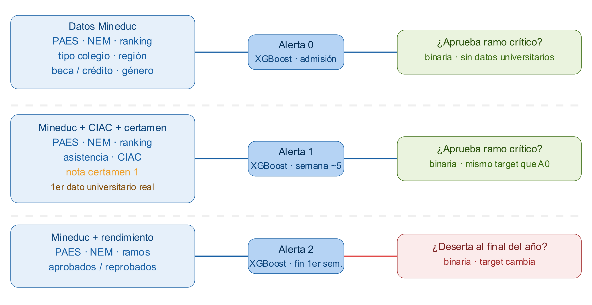
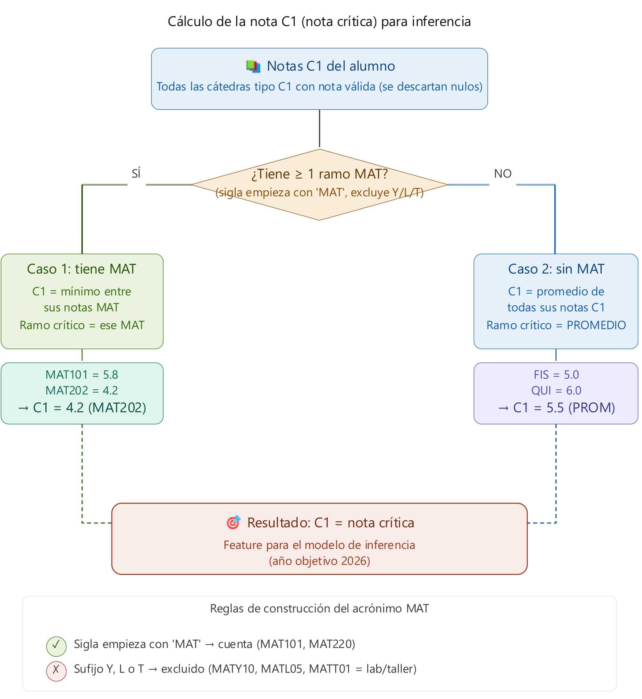
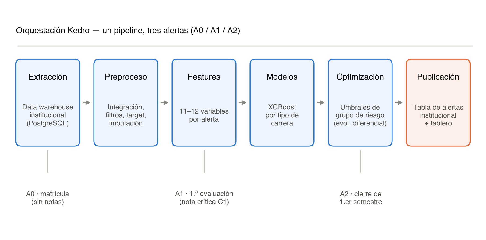
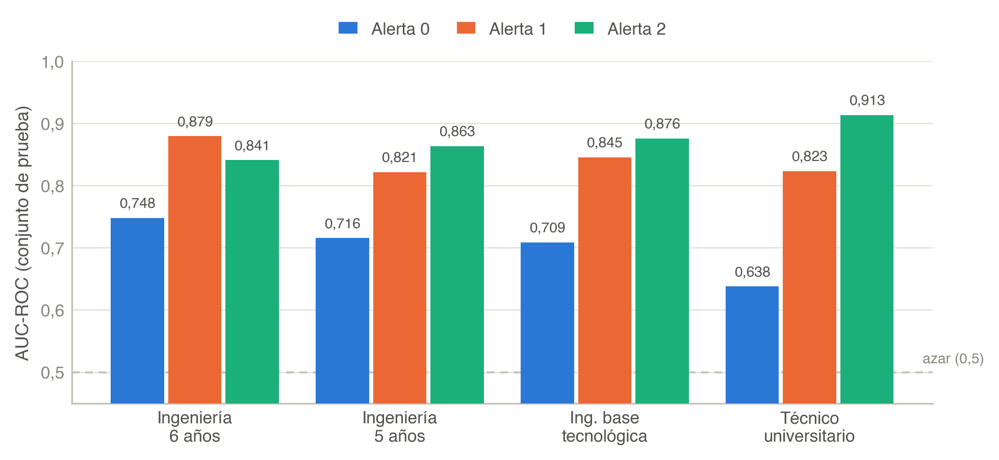
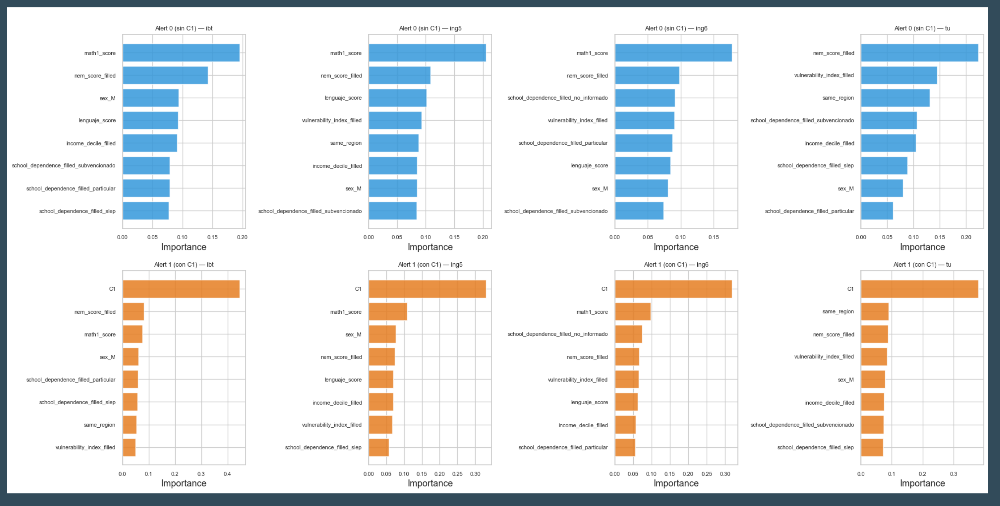
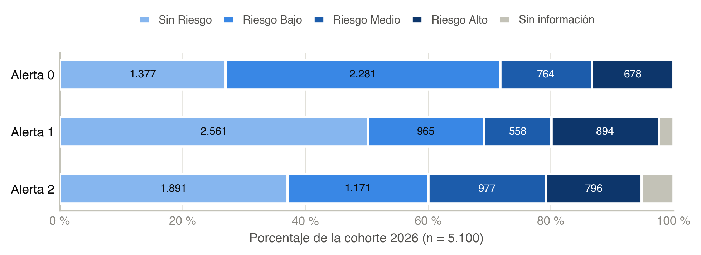
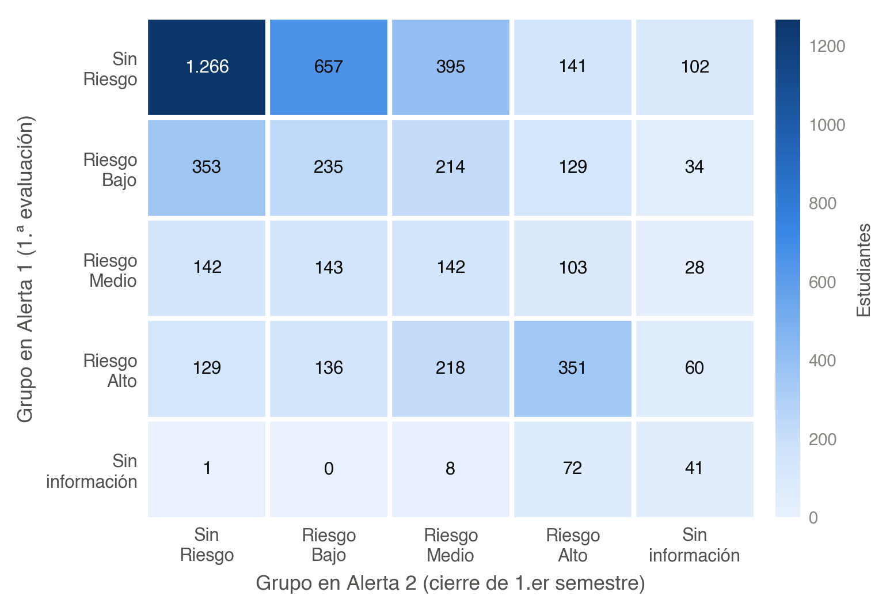
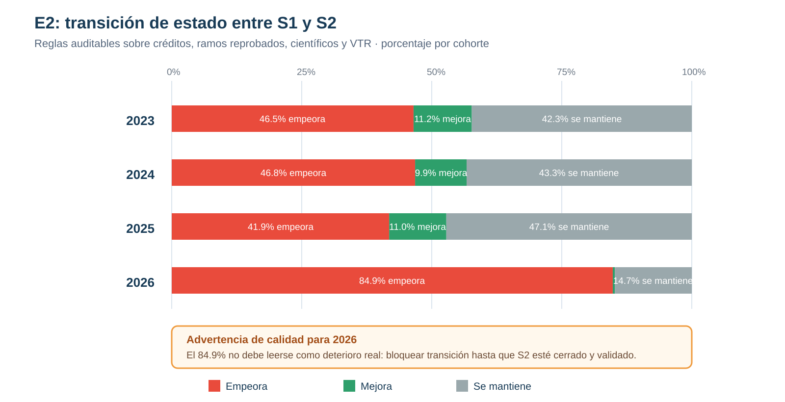

##  {data-state="no-logo" background-image="figuras/portada.png" background-size="cover" background-position="center"}

::: notes
Duración sugerida: 25 segundos. Presentar el trabajo como un sistema institucional que actualiza la prioridad de acompañamiento en tres momentos del primer año.
:::

------------------------------------------------------------------------

## SAT-E: una cohorte, tres alertas, una prioridad que se actualiza

:::::::::::::: columns
:::::: {.column .question-col width="58%"}
::: eyebrow
Pregunta de investigación
:::

### ¿Cómo anticipar el riesgo académico sin convertir una probabilidad en un veredicto?

::: lead
SAT-E integra datos de admisión y trayectoria para emitir alertas secuenciales sobre la misma cohorte. Cada alerta responde a la información disponible en un hito distinto del calendario.
:::

::: {.box .teal .fragment}
**Contribución** La predicción se convierte en una lista priorizada y operable para equipos humanos de acompañamiento.
:::
::::::

::::::::: {.column width="42%"}
:::::::: {.panel-dark .thesis .fragment}
::: mark-top
SOCHEDI 2026 · avance de investigación
:::

::: mark-title
El dato nuevo no reemplaza la alerta: la actualiza.
:::

::: mark-line
<strong>3</strong>alertas sobre la misma cohorte
:::

::: mark-line
<strong>5.100</strong>estudiantes cohorte 2026
:::

::: mark-line
<strong>81</strong>programas en 5 campus y sedes
:::
::::::::
:::::::::
::::::::::::::

::: notes
Duración sugerida: 55 segundos. La pregunta no es solamente si se puede predecir riesgo. Es si la predicción llega a tiempo, respeta la heterogeneidad de las carreras y puede transformarse en una decisión institucional de acompañamiento.
:::

------------------------------------------------------------------------

## Tres alertas sobre la misma cohorte

::: {.fig style="--h: 680px"}
{fig-alt="Datos, modelos y objetivos de las alertas A0, A1 y A2"}
:::

::: notes
Duración sugerida: 40 segundos. Recorrer la figura por filas: datos, modelo y evento objetivo de cada alerta. A0 y A1 permiten una comparación directa porque predicen el mismo evento.
:::

------------------------------------------------------------------------

## Tres alertas · qué aporta cada hito

::::::::: {.grid-3 .timeline .roomy}
:::: {.card .a0 .fragment}
::: badge
A0
:::

### Matrícula

**Anticipación máxima**

Predice reprobación del ramo crítico con antecedentes de admisión.
::::

:::: {.card .a1 .fragment}
::: badge
A1
:::

### Tras C1

**Primera evidencia de trayectoria**

Agrega la nota crítica y mantiene el mismo evento objetivo.
::::

:::: {.card .a2 .fragment}
::: badge
A2
:::

### Cierre del semestre

**Actualización curricular**

Agrega créditos aprobados y predice no retención a un año.
::::
:::::::::

::: notes
Duración sugerida: 35 segundos. A0 y A1 comparten el evento objetivo. A2 cambia el target: no es una tercera medición de aprobación, sino una alerta de retención.
:::

------------------------------------------------------------------------

## Alerta 0 · anticipación máxima

:::::::::: columns
::::: {.column width="56%"}
### Lo que se sabe en matrícula

::: incremental
-   Puntajes de acceso y NEM.
-   Contexto socioeconómico y procedencia.
-   Dependencia del establecimiento y coincidencia regional.
-   Tipo de carrera y programa.
:::

::: box
**Evento objetivo** Reprobación de la asignatura crítica de matemática durante el primer semestre.
:::
:::::

:::::: {.column width="44%"}
::::: stack
::: {.kpi .a0 .fragment}
[A0]{.tag} [0,708]{.value}

<strong>AUC-ROC ponderado</strong> Conjunto de prueba.

<strong>Valor institucional</strong> Abre una ventana de apoyo antes de que exista evidencia de desempeño universitario.

:::

::: {.box .warn .fragment}
**Límite** En Técnico Universitario alcanza AUC 0,638: el perfil de ingreso contiene menos señal predictiva.
:::
:::::
::::::
::::::::::

::: notes
Duración sugerida: 1 minuto. A0 no debe evaluarse como una etiqueta definitiva. Su valor es abrir anticipadamente la conversación y permitir que el equipo de apoyo actúe con la información disponible.
:::

------------------------------------------------------------------------

## Alerta 1 · la primera señal de trayectoria

::::::::: columns
:::: {.column width="52%"}
### La nota crítica C1

::: incremental
-   Si existen ramos MAT, se toma la **peor nota C1**.
-   Se excluyen laboratorios y talleres (`Y`, `L`, `T`).
-   Sin ramos MAT, se usa el promedio C1 disponible.
:::
::::

:::::: {.column width="48%"}
::::: stack
::: {.kpi .a1 .fragment}
[A1]{.tag} [0,853]{.value}

<strong>AUC-ROC ponderado</strong> Un aumento de 0,145 respecto de A0 con una sola variable adicional.

:::

::: {.box .warn .fragment}
**Condición de operación** La alerta solo puede mejorar si la nota se registra a tiempo. En la cohorte 2026, C1 estuvo disponible para 2.575 de 5.100 estudiantes.
:::
:::::
::::::
:::::::::

::: notes
Duración sugerida: 1 minuto 15 segundos. Este es el hallazgo central: la primera respuesta observable del estudiante al régimen universitario aporta más señal que el perfil de ingreso aislado. El cuello de botella deja de ser el modelo y pasa a ser la disponibilidad oportuna de C1.
:::

------------------------------------------------------------------------

## Apoyo · regla de cálculo de la nota crítica C1

::::: r-stack
::: {.crop .fragment .fade-out data-fragment-index="1" style="--iw: 1751; --x: 0; --y: 100; --cw: 1751; --ch: 1070; height: 700px;"}

:::

::: {.crop .fragment data-fragment-index="1" style="--iw: 1751; --x: 0; --y: 1150; --cw: 1751; --ch: 755; height: 610px;"}

:::
:::::

::: notes
Diapositiva de apoyo, opcional (hasta 20 segundos o ante preguntas). Primero la decisión: con ramos MAT se toma la peor nota; sin ramos MAT, el promedio C1. Luego el resultado y las reglas de exclusión de laboratorios y talleres.
:::

------------------------------------------------------------------------

## Alerta 2 · trayectoria curricular y no retención

::::::::: columns
:::: {.column width="54%"}
### Qué cambia al cierre del semestre

::: incremental
-   Se incorpora la **razón de créditos aprobados sobre inscritos**.
-   El objetivo pasa a ser **no retención a un año**.
-   El modelo usa la trayectoria efectiva, no solo antecedentes previos.
:::
::::

:::::: {.column width="46%"}
::::: stack
::: {.kpi .a2 .fragment}
[A2]{.tag} [0,870]{.value}

<strong>AUC-ROC ponderado</strong> Mejor desempeño, para un evento distinto y menos frecuente.

:::

::: {.box .fragment}
**Interpretación** A2 refina la prioridad durante el semestre; no “corrige” una predicción de A0 o A1.
:::
:::::
::::::
:::::::::

::: notes
Duración sugerida: 40 segundos. La secuencia permite que A2 sea más informativa sin sacrificar la anticipación de A0.
:::

------------------------------------------------------------------------

## Arquitectura · un pipeline, tres alertas

::: {.fig style="--h: 680px"}
{fig-alt="Pipeline SAT-E y momentos de emisión de las alertas"}
:::

::: notes
Duración sugerida: 20 segundos. La figura resume la arquitectura reproducible: extracción, preprocesamiento, variables, modelos, optimización y publicación.
:::

------------------------------------------------------------------------

## De la probabilidad al grupo de riesgo

::::::::: columns
::::: {.column width="50%"}
### Una salida operable

Los modelos XGBoost se entrenan por alerta y tipo de carrera. La probabilidad continua se traduce en:

:::: panel-dark
<h3>Grupos de acompañamiento</h3>

::: risk-scale
[Sin riesgo]{.si}[Riesgo bajo]{.sr}[Riesgo medio]{.rm}[Riesgo alto]{.ra}
:::

Umbrales específicos por alerta y tipo de carrera.

::::
:::::

::::: {.column width="50%"}
### Optimización con restricciones

::: incremental
-   Evolución diferencial con semilla fija.
-   Separación entre grupos en una variable interpretable.
-   Tamaño mínimo y máximo por grupo.
-   Capacidad real de las unidades de acompañamiento.
:::

::: {.box .warn .fragment}
**Uso responsable** Un grupo de riesgo es una prioridad operativa dentro de una cohorte; no es una identidad, destino ni decisión automática sobre el estudiante.
:::
:::::
:::::::::

::: notes
Duración sugerida: 1 minuto. El sistema no entrega solo un ranking. Los umbrales se diseñan para producir grupos que un equipo pueda atender y comunicar con cautela.
:::

------------------------------------------------------------------------

## Resultados · la trayectoria mueve la señal

::: {.fig style="--h: 520px"}
{fig-alt="AUC-ROC por alerta y tipo de carrera"}
:::

::: fig-caption
AUC-ROC en el conjunto de prueba por tipo de carrera. La línea discontinua representa azar (0,5).
:::

::: {.box .teal .fragment}
**Lectura principal** A1 supera a A0 en los cuatro tipos de carrera; A2 alcanza el valor ponderado más alto, aunque predice no retención y no el mismo evento académico.
:::

::: notes
Duración sugerida: 1 minuto 10 segundos. La figura muestra el patrón completo: el salto entre A0 y A1 es consistente y A2 mantiene un desempeño alto. Evitar ordenar las alertas como si fueran modelos equivalentes: cambian los datos y, en A2, también cambia el target.
:::

------------------------------------------------------------------------

## Resultados · cambia la importancia de las variables

:::::::::: columns
:::: {.column width="66%"}
::: {.fig style="--h: 640px"}
{fig-alt="Importancia relativa de variables en las alertas 0 y 1"}
:::
::::

::::::: {.column width="34%"}
:::::: stack
::: {.kpi .a0 .compact .fragment}
[A0]{.tag}

La señal se reparte entre puntajes de acceso, NEM y contexto socioeconómico.

:::

::: {.kpi .a1 .compact .fragment}
[A1]{.tag}

C1 ocupa el primer lugar en los cuatro tipos de carrera.

:::

::: {.box .gray .fragment}
**Cautela** Importancia predictiva no significa causalidad.
:::
::::::
:::::::
::::::::::

::: notes
Duración sugerida: 55 segundos. La importancia de variables confirma la lectura de AUC, pero no debe convertirse en una explicación causal de la trayectoria de un estudiante. Las dos diapositivas siguientes amplían la figura por tipo de carrera.
:::

------------------------------------------------------------------------

## Apoyo · importancia de variables en A0 (sin C1)

::::: r-stack
::: {.crop .fragment .fade-out data-fragment-index="1" style="--iw: 3251; --x: 0; --y: 0; --cw: 1626; --ch: 824; height: 690px;"}

:::

::: {.crop .fragment data-fragment-index="1" style="--iw: 3251; --x: 1625; --y: 0; --cw: 1626; --ch: 824; height: 690px;"}

:::
:::::

::: notes
Diapositiva de apoyo, opcional (hasta 10 segundos o ante preguntas). En A0 lideran los puntajes de acceso y el NEM; en Técnico Universitario pesa más el contexto socioeconómico.
:::

------------------------------------------------------------------------

## Apoyo · importancia de variables en A1 (con C1)

::::: r-stack
::: {.crop .fragment .fade-out data-fragment-index="1" style="--iw: 3251; --x: 0; --y: 823; --cw: 1626; --ch: 824; height: 690px;"}

:::

::: {.crop .fragment data-fragment-index="1" style="--iw: 3251; --x: 1625; --y: 823; --cw: 1626; --ch: 824; height: 690px;"}

:::
:::::

::: notes
Diapositiva de apoyo, opcional (hasta 10 segundos o ante preguntas). En A1, C1 ocupa el primer lugar en los cuatro tipos de carrera.
:::

------------------------------------------------------------------------

## Cohorte 2026 · la composición cambia con cada alerta

::: {.fig style="--h: 450px"}
{fig-alt="Distribución de la cohorte 2026 por grupo de riesgo y alerta"}
:::

::: fig-caption
Cohorte 2026: n = 5.100. La categoría Sin información se mantiene visible.
:::

:::::: grid-3
::: {.kpi .a0 .fragment}
[A0]{.tag} [1.442]{.value}

Riesgo medio + alto.

:::

::: {.kpi .a1 .fragment}
[A1]{.tag} [894]{.value}

Riesgo alto; 122 sin información.

:::

::: {.kpi .a2 .fragment}
[A2]{.tag} [1.773]{.value}

Riesgo medio + alto; 265 sin información.

:::
::::::

::: notes
Duración sugerida: 1 minuto. La alerta transforma un score en una composición de grupos. El hecho de que las cantidades cambien es precisamente la razón para actualizar la prioridad durante el semestre.
:::

------------------------------------------------------------------------

## Cohorte 2026 · transición entre A1 y A2

::::::::::: columns
::::: {.column width="64%"}
::: {.fig style="--h: 500px"}
{fig-alt="Transición entre grupos de riesgo A1 y A2"}
:::

::: fig-caption
Cruce de grupos en la cohorte 2026. A1 y A2 predicen eventos diferentes.
:::
:::::

::::::: {.column width="36%"}
:::::: stack
::: {.kpi .compact .fragment}
[2.035]{.value}

permanecen en el mismo grupo: 39,9 %.

:::

::: {.kpi .compact .a1 .fragment}
[1.720]{.value}

suben en severidad: 33,7 %.

:::

::: {.kpi .compact .a2 .fragment}
[1.345]{.value}

bajan en severidad: 26,4 %.

:::
::::::
:::::::
:::::::::::

::: {.box .teal .fragment}
**Implicancia** Seis de cada diez estudiantes cambian de grupo. Una alerta única congelaría demasiado pronto la prioridad de acompañamiento.
:::

::: notes
Duración sugerida: 1 minuto. Leer la transición como actualización de prioridad. No representa una “corrección” del mismo pronóstico porque A2 cambia el resultado que se quiere anticipar.
:::

------------------------------------------------------------------------

## Calidad de datos · “Sin información” también es una alerta

::::::: columns
:::: {.column width="56%"}
### El faltante se publica, no se inventa

::: incremental
-   A1: **122** estudiantes sin C1.
-   A2: **265** sin razón de créditos aprobados.
-   En A2, **216 (81,5 %)** sí tienen C1 registrada: el problema suele estar en el cómputo curricular.
-   La categoría faltante orienta la corrección del proceso de datos.
:::
::::

:::: {.column width="44%"}
 

::: {.box .warn .fragment}
**Regla conservadora** Cuando falta la variable distintiva, SAT-E entrega “Sin información” y no una probabilidad basada en un valor imputado.
:::
::::
:::::::

::: notes
Duración sugerida: 35 segundos. El faltante no se oculta ni se imputa: se publica como categoría propia y se rastrea hasta su origen en el proceso de datos.
:::

------------------------------------------------------------------------

## Calidad de datos · transiciones de estado y advertencia 2026

::: {.fig style="--h: 690px"}
{fig-alt="Transiciones de estado y advertencia de calidad para 2026"}
:::

::: notes
Duración sugerida: 25 segundos. Esta es una contribución no prevista inicialmente: el sistema también audita la calidad operacional de los datos que sostienen las alertas.
:::

------------------------------------------------------------------------

## Discusión · alcance y próximos pasos

:::::: {.grid-3 .roomy}
::: {.card .done .fragment}
### Lo que muestra este avance

-   La trayectoria temprana aporta más señal que el ingreso aislado.
-   La secuencia actualiza la prioridad.
-   Los umbrales producen grupos operables.
:::

::: {.card .limit .fragment}
### Lo que todavía no demuestra

-   No estima impacto causal del acompañamiento.
-   La validación interna no reemplaza la temporal.
-   Debe monitorearse equidad y drift.
:::

::: {.card .next .fragment}
### La siguiente evaluación

-   Registrar contacto e intervención.
-   Validar en cohortes posteriores.
-   Evaluar lista de espera o diseño cuasiexperimental.
:::
::::::

::: notes
Duración sugerida: 1 minuto. Cerrar con la distinción científica entre identificación e impacto. El sistema demuestra capacidad predictiva y operativa; el efecto del acompañamiento requiere otra evaluación.
:::

------------------------------------------------------------------------

## Conclusiones

### Tres resultados

::::::::: {.grid-3 .timeline .roomy}
:::: {.card .a0 .fragment}
::: badge
1
:::

**A0 abre la ventana:** permite priorizar antes del primer desempeño universitario.
::::

:::: {.card .a1 .fragment}
::: badge
2
:::

**A1 revela la trayectoria:** C1 eleva el AUC ponderado de 0,708 a 0,853.
::::

:::: {.card .a2 .fragment}
::: badge
3
:::

**A2 actualiza la acción:** el avance curricular permite anticipar no retención con AUC 0,870.
::::
:::::::::

::: notes
Duración sugerida: 30 segundos. Recorrer los tres resultados en orden: A0 abre la ventana, A1 revela la trayectoria y A2 actualiza la acción.
:::

------------------------------------------------------------------------

## Conclusiones · mensaje final

 

::: {.box .warn .roomy}
**Mensaje metodológico:** las alertas son momentos de decisión y no etiquetas permanentes del estudiante.
:::

 

::: {.panel-dark .roomy .fragment}

<strong>CONCLUSIÓN</strong>

El valor de SAT-E está en conectar datos oportunos, modelos interpretables y capacidad real de acompañamiento.

:::

::: notes
Duración sugerida: 20 segundos. La tesis final es que la mejora más importante no viene de complejizar el modelo, sino de observar y registrar a tiempo la trayectoria que el modelo necesita.
:::

------------------------------------------------------------------------

## Fuentes principales · gracias

:::::: columns
::: {.column .references width="62%"}
### Fuente base

Alfaro Medina, F., Canales Pozo, V. y Olivares, P. (2026). *SAT-E: Sistema de alerta temprana multinivel para la detección de riesgo académico y deserción en estudiantes de primer año de ingeniería*. Propuesta SOCHEDI 2026.

### Referencias metodológicas

Tinto (1975, 1993); Siemens y Long (2011); Arnold y Pistilli (2012); Chen y Guestrin (2016); Lundberg y Lee (2017); Storn y Price (1997).
:::

:::: {.column width="38%"}
::: {.panel-dark .questions-panel style="min-height: 420px;"}
[¿Preguntas?]{.big}
:::
::::
::::::

::: notes
Preguntas previsibles: qué ocurre con estudiantes sin C1, cómo se fijan los umbrales, qué intervención activa cada grupo, cómo se validará el impacto y qué resguardos de privacidad y equidad se aplican.
:::