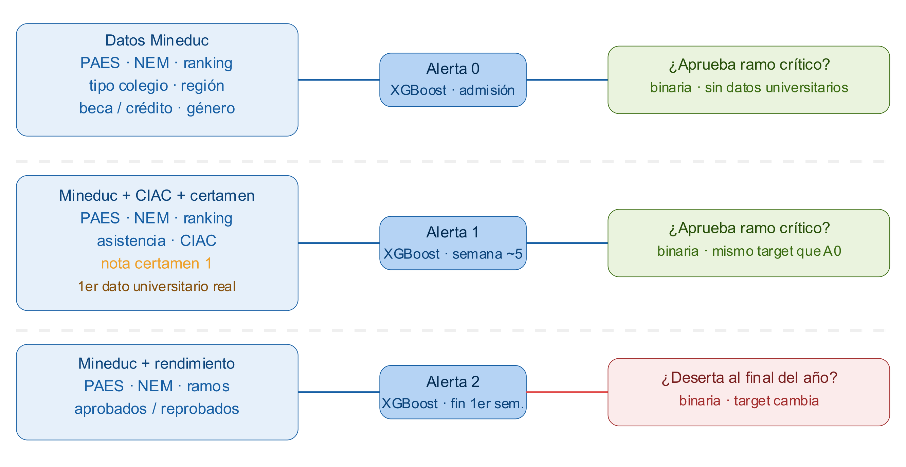
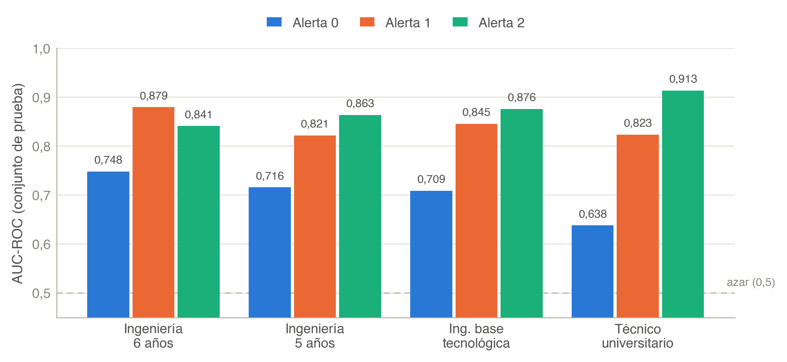
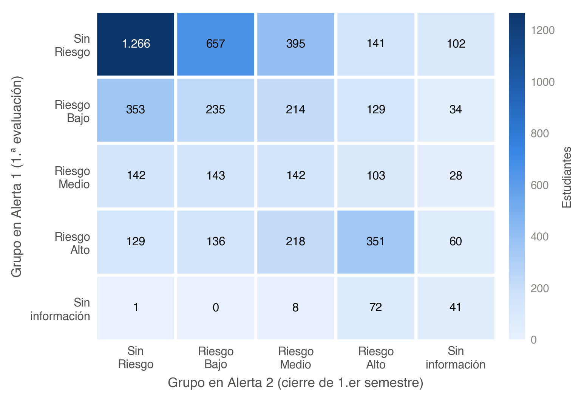
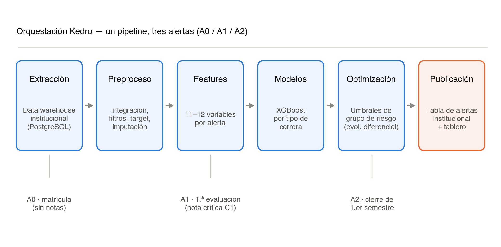

##  {data-state="no-logo" background-image="figuras/portada.png" background-size="cover" background-position="center"}

::: notes
SAT-E es un sistema institucional para actualizar la prioridad de acompañamiento durante el primer año.
:::

------------------------------------------------------------------------

## SAT-E: anticipar, actualizar y acompañar

:::::::::::::: columns
:::::: {.column width="58%"}
::: eyebrow
Pregunta de investigación
:::

### ¿Cómo anticipar el riesgo académico sin convertir una probabilidad en un veredicto?

::: lead
SAT-E integra datos de admisión y trayectoria para emitir alertas secuenciales sobre la misma cohorte. Cada alerta usa la información disponible en un hito distinto del calendario.
:::

::: {.box .teal .fragment}
**Contribución** La predicción se convierte en una lista priorizada y operable para equipos humanos de acompañamiento.
:::
::::::

::::::::: {.column width="42%"}
:::::::: {.panel-dark .thesis .fragment}
::: mark-top
SOCHEDI 2026 · avance de investigación
:::

::: mark-title
El dato nuevo no reemplaza la alerta: la actualiza.
:::

::: mark-line
<strong>3</strong>alertas sobre la misma cohorte
:::

::: mark-line
<strong>5.100</strong>estudiantes cohorte 2026
:::

::: mark-line
<strong>81</strong>programas en 5 campus y sedes
:::
::::::::
:::::::::
::::::::::::::

::: notes
SAT-E no decide por el estudiante: ordena prioridades de acompañamiento y las actualiza cuando aparece nueva evidencia.
:::

------------------------------------------------------------------------

## Tres alertas sobre la misma cohorte

::: {.fig style="--h: 650px"}
{fig-alt="Datos, modelos y objetivos de las alertas A0, A1 y A2"}
:::

::: {.box .teal .fragment}
**Idea central** A0 maximiza anticipación; A1 incorpora la primera señal de trayectoria; A2 actualiza la prioridad con el avance curricular.
:::

------------------------------------------------------------------------

## Qué aporta cada hito

::::::::: {.grid-3 .timeline .roomy}
:::: {.card .a0 .fragment}
::: badge
A0
:::

### Matrícula

**Anticipación máxima**

Antecedentes de admisión antes de que exista evidencia universitaria.
::::

:::: {.card .a1 .fragment}
::: badge
A1
:::

### Tras C1

**Primera señal de trayectoria**

Agrega la nota crítica y mantiene el evento de reprobación.
::::

:::: {.card .a2 .fragment}
::: badge
A2
:::

### Cierre del semestre

**Actualización curricular**

Agrega créditos aprobados y anticipa no retención a un año.
::::
:::::::::

::: {.box .warn .fragment}
**Regla de lectura** A2 no corrige A0 o A1: responde a otra pregunta con información más reciente.
:::

------------------------------------------------------------------------

## La trayectoria agrega señal

:::::::::: columns
::::: {.column width="64%"}
::: {.fig style="--h: 590px"}
{fig-alt="AUC-ROC por alerta y tipo de carrera"}
:::

::: fig-caption
AUC-ROC en el conjunto de prueba. La línea discontinua representa azar (0,5).
:::
:::::

:::::: {.column width="36%"}
::: {.kpi .a0 .fragment}
[A0]{.tag} [0,708]{.value}

Los antecedentes de ingreso abren la ventana de intervención.

:::

::: {.kpi .a1 .fragment}
[A1]{.tag} [0,853]{.value}

La nota C1 agrega una señal fuerte.

:::

::: {.kpi .a2 .fragment}
[A2]{.tag} [0,870]{.value}

Mejor desempeño para un evento distinto: no retención.

:::
::::::
::::::::::

::: notes
No ordenar las alertas como si fueran equivalentes: cambian los datos y, en A2, también cambia el evento objetivo.
:::

------------------------------------------------------------------------

## De la probabilidad a una prioridad operable

::::::::::: columns
::::: {.column width="48%"}
### Grupos de acompañamiento

Los modelos XGBoost se entrenan por alerta y tipo de carrera. La probabilidad continua se traduce en grupos que un equipo puede priorizar.

::: panel-dark
<h3>Escala de riesgo</h3>

::: risk-scale
[Sin riesgo]{.si}[Riesgo bajo]{.sr}[Riesgo medio]{.rm}[Riesgo alto]{.ra}
:::

Umbrales específicos por alerta y tipo de carrera.

:::
:::::

::::: {.column width="52%"}
::: {.fig style="--h: 455px"}
{fig-alt="Transición entre grupos de riesgo A1 y A2"}
:::

::: fig-caption
En la cohorte 2026, seis de cada diez estudiantes cambian de grupo entre A1 y A2.
:::
:::::
:::::::::::

::: {.box .warn .fragment}
**Uso responsable** Un grupo de riesgo es una prioridad operativa, no una identidad, destino ni decisión automática sobre el estudiante.
:::

------------------------------------------------------------------------

## Un sistema reproducible y consciente de sus datos

:::::::::: columns
::::: {.column width="58%"}
::: {.fig style="--h: 570px"}
{fig-alt="Pipeline SAT-E y momentos de emisión de las alertas"}
:::
:::::

:::::: {.column width="42%"}
### Del dato a la intervención

::: incremental
- Integración de fuentes institucionales.
- Variables y modelos por tipo de carrera.
- Umbrales, grupos y publicación para acompañamiento.
:::

::: {.box .warn .fragment}
**Calidad de datos** Cuando falta la variable distintiva, SAT-E publica **Sin información**: no inventa una probabilidad mediante imputación.
:::
::::::
::::::::::

------------------------------------------------------------------------

## Qué muestra este avance

::::::::: {.grid-3 .roomy}
::: {.card .done .fragment}
### Lo que muestra

- La trayectoria aporta señal adicional.
- La secuencia actualiza la prioridad.
- Los umbrales producen grupos operables.
:::

::: {.card .limit .fragment}
### Lo que no demuestra

- No estima el impacto causal del acompañamiento.
- La validación interna no reemplaza la temporal.
- Deben monitorearse equidad y drift.
:::

::: {.card .next .fragment}
### Próximo paso

- Registrar contacto e intervención.
- Validar en cohortes posteriores.
- Evaluar un diseño cuasiexperimental.
:::
::::::

------------------------------------------------------------------------

## Tres mensajes para llevar

::::::::: {.grid-3 .timeline .roomy}
:::: {.card .a0 .fragment}
::: badge
1
:::

**A0 abre la ventana:** prioriza antes del primer desempeño universitario.
::::

:::: {.card .a1 .fragment}
::: badge
2
:::

**A1 revela la trayectoria:** C1 eleva el AUC ponderado de 0,708 a 0,853.
::::

:::: {.card .a2 .fragment}
::: badge
3
:::

**A2 actualiza la acción:** el avance curricular anticipa no retención con AUC 0,870.
::::
:::::::::

::: {.box .warn .roomy}
**Mensaje metodológico:** las alertas son momentos de decisión y no etiquetas permanentes del estudiante.
:::
