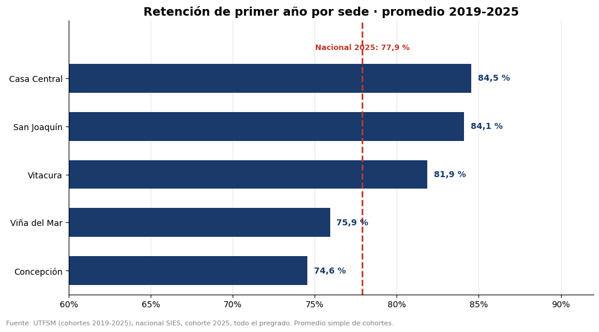
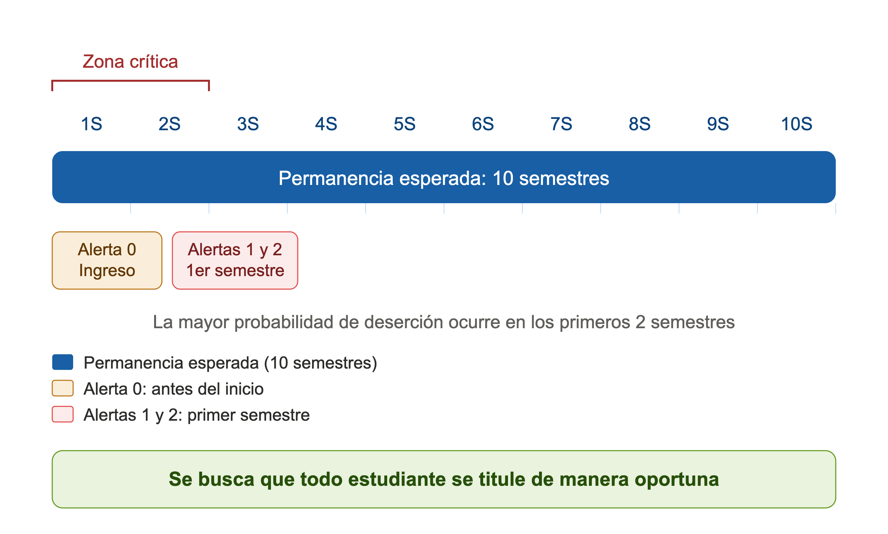
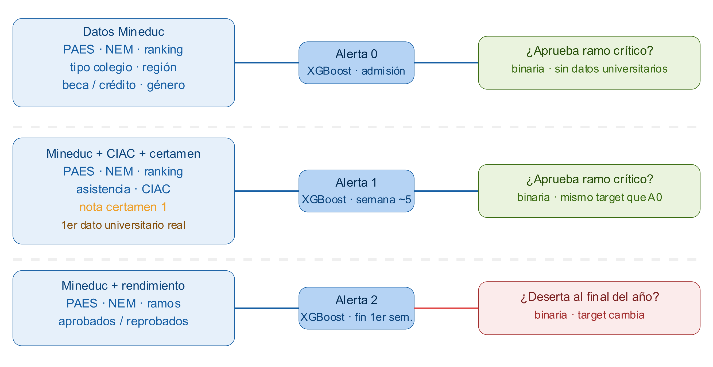
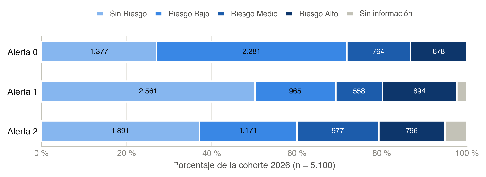
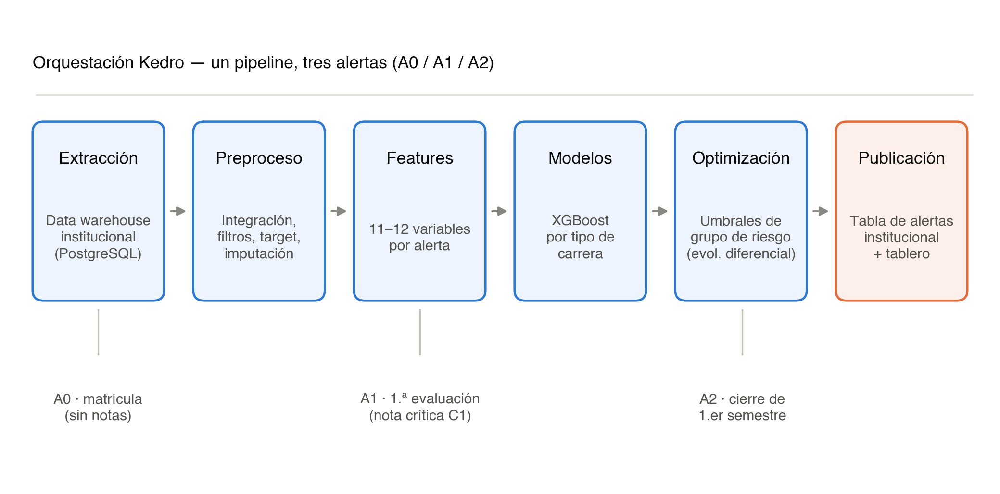
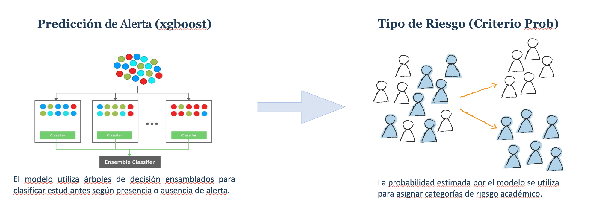
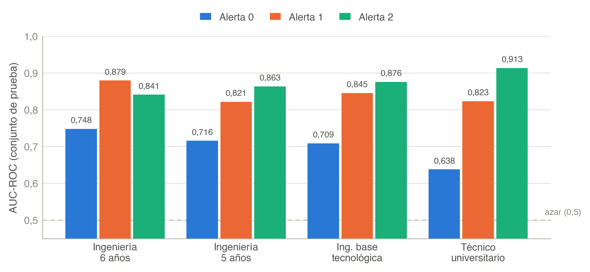
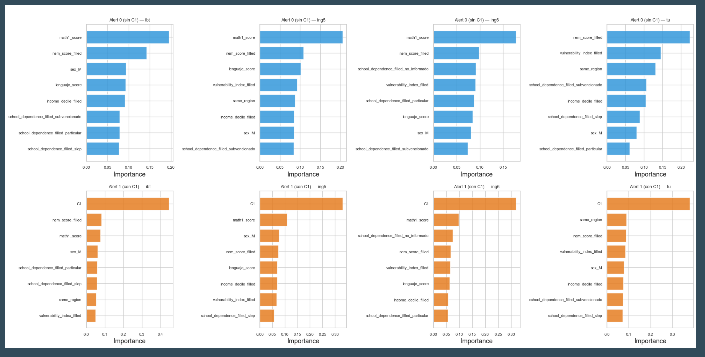
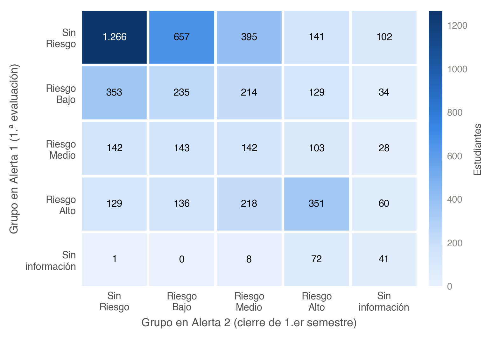
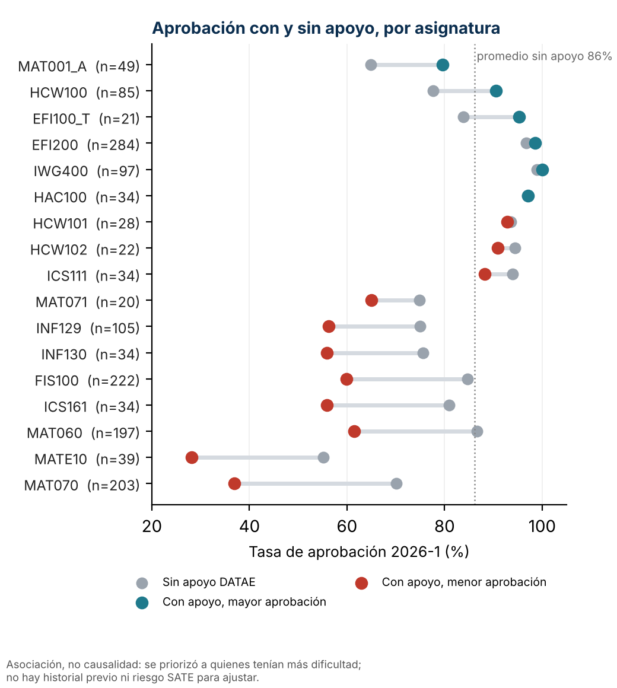

##  {data-state="no-logo" background-image="figuras/portada.png" background-size="cover" background-position="center"}

::: notes
Duración sugerida: 25 segundos. Presentar el trabajo como un sistema institucional que actualiza la prioridad de acompañamiento en tres momentos del primer año.
:::

------------------------------------------------------------------------

## 

::: r-stack
  

{.fragment .fade-in-then-out fig-align="center" width="1200px"}

{.fragment  fig-align="center" width="1200px"}

:::

## SAT-E: una cohorte, tres alertas, una prioridad que se actualiza

:::::::::::::: columns
:::::: {.column .question-col width="58%"}
::: eyebrow
Pregunta de investigación
:::

### ¿Cómo anticipar el riesgo académico sin convertir una probabilidad en un veredicto?

::: lead
SAT-E integra datos de admisión y trayectoria para emitir alertas secuenciales sobre la misma cohorte. Cada alerta responde a la información disponible en un hito distinto del calendario.
:::

::: {.box .teal .fragment}
**Contribución** La predicción se convierte en una lista priorizada y operable para equipos humanos de acompañamiento.
:::
::::::

::::::::: {.column width="42%"}
:::::::: {.panel-dark .thesis .fragment}
::: mark-top
SOCHEDI 2026 · avance de investigación
:::

::: mark-title
El dato nuevo no reemplaza la alerta: la actualiza.
:::

::: mark-line
<strong>3</strong>alertas sobre la misma cohorte
:::

::: mark-line
<strong>5.100</strong>estudiantes cohorte 2026
:::

::: mark-line
<strong>81</strong>programas en 5 campus y sedes
:::
::::::::
:::::::::
::::::::::::::

::: notes
Duración sugerida: 55 segundos. La pregunta no es solamente si se puede predecir riesgo. Es si la predicción llega a tiempo, respeta la heterogeneidad de las carreras y puede transformarse en una decisión institucional de acompañamiento.
:::

------------------------------------------------------------------------

## Tres alertas sobre la misma cohorte

::: {.fig style="--h: 680px"}
{fig-alt="Datos, modelos y objetivos de las alertas A0, A1 y A2"}
:::

::: notes
Duración sugerida: 40 segundos. Recorrer la figura por filas: datos, modelo y evento objetivo de cada alerta. A0 y A1 permiten una comparación directa porque predicen el mismo evento.
:::

------------------------------------------------------------------------

## Cohorte 2026 · la composición cambia con cada alerta

::: {.fig style="--h: 450px"}
{fig-alt="Distribución de la cohorte 2026 por grupo de riesgo y alerta"}
:::

::: fig-caption
Cohorte 2026: n = 5.100. La categoría Sin información se mantiene visible.
:::

:::::: grid-3
::: {.kpi .a0 .fragment}
[A0]{.tag} [1.442]{.value}

Riesgo medio + alto.

:::

::: {.kpi .a1 .fragment}
[A1]{.tag} [894]{.value}

Riesgo alto; 122 sin información.

:::

::: {.kpi .a2 .fragment}
[A2]{.tag} [1.773]{.value}

Riesgo medio + alto; 265 sin información.

:::
::::::

::: notes
Duración sugerida: 1 minuto. La alerta transforma un score en una composición de grupos. El hecho de que las cantidades cambien es precisamente la razón para actualizar la prioridad durante el semestre.
:::

------------------------------------------------------------------------

## Arquitectura · un pipeline, tres alertas

::: r-stack
  

{.fragment .fade-in-then-out fig-align="center" width="1500px"}

{.fragment  fig-align="center" width="1500px"}

:::

::: notes
Duración sugerida: 20 segundos. La figura resume la arquitectura reproducible: extracción, preprocesamiento, variables, modelos, optimización y publicación.
:::

------------------------------------------------------------------------

## Resultados · la trayectoria mueve la señal

::: {.fig style="--h: 520px"}
{fig-alt="AUC-ROC por alerta y tipo de carrera"}
:::

::: fig-caption
AUC-ROC en el conjunto de prueba por tipo de carrera. La línea discontinua representa azar (0,5).
:::

::: {.box .teal .fragment}
**Lectura principal** A1 supera a A0 en los cuatro tipos de carrera; A2 alcanza el valor ponderado más alto, aunque predice no retención y no el mismo evento académico.
:::

::: notes
Duración sugerida: 1 minuto 10 segundos. La figura muestra el patrón completo: el salto entre A0 y A1 es consistente y A2 mantiene un desempeño alto. Evitar ordenar las alertas como si fueran modelos equivalentes: cambian los datos y, en A2, también cambia el target.
:::

------------------------------------------------------------------------

## Apoyo · importancia de variables en A0 (sin C1)

::::: r-stack
::: {.crop .fragment .fade-out data-fragment-index="1" style="--iw: 3251; --x: 0; --y: 0; --cw: 1626; --ch: 824; height: 690px;"}

:::

::: {.crop .fragment data-fragment-index="1" style="--iw: 3251; --x: 1625; --y: 0; --cw: 1626; --ch: 824; height: 690px;"}

:::
:::::

::: notes
Diapositiva de apoyo, opcional (hasta 10 segundos o ante preguntas). En A0 lideran los puntajes de acceso y el NEM; en Técnico Universitario pesa más el contexto socioeconómico.
:::

------------------------------------------------------------------------

## Apoyo · importancia de variables en A1 (con C1)

::::: r-stack
::: {.crop .fragment .fade-out data-fragment-index="1" style="--iw: 3251; --x: 0; --y: 823; --cw: 1626; --ch: 824; height: 690px;"}

:::

::: {.crop .fragment data-fragment-index="1" style="--iw: 3251; --x: 1625; --y: 823; --cw: 1626; --ch: 824; height: 690px;"}

:::
:::::

::: notes
Diapositiva de apoyo, opcional (hasta 10 segundos o ante preguntas). En A1, C1 ocupa el primer lugar en los cuatro tipos de carrera.
:::

------------------------------------------------------------------------

## Cohorte 2026 · transición entre A1 y A2

::::::::::: columns
::::: {.column width="64%"}
::: {.fig style="--h: 500px"}
{fig-alt="Transición entre grupos de riesgo A1 y A2"}
:::

::: fig-caption
Cruce de grupos en la cohorte 2026. A1 y A2 predicen eventos diferentes.
:::
:::::

::::::: {.column width="36%"}
:::::: stack
::: {.kpi .compact .fragment}
[2.035]{.value}

permanecen en el mismo grupo: 39,9 %.

:::

::: {.kpi .compact .a1 .fragment}
[1.720]{.value}

suben en severidad: 33,7 %.

:::

::: {.kpi .compact .a2 .fragment}
[1.345]{.value}

bajan en severidad: 26,4 %.

:::
::::::
:::::::
:::::::::::

::: {.box .teal .fragment}
**Implicancia** Seis de cada diez estudiantes cambian de grupo. Una alerta única congelaría demasiado pronto la prioridad de acompañamiento.
:::

::: notes
Duración sugerida: 1 minuto. Leer la transición como actualización de prioridad. No representa una “corrección” del mismo pronóstico porque A2 cambia el resultado que se quiere anticipar.
:::

## Impacto y cobertura

::: {.columns}
::: {.column width="42%"}

 

**Indicadores DATAE**

- **Cobertura:** estudiantes válidos con al menos una asistencia.
- **Movilidad SATE:** cambio de riesgo entre alertas.
- **RAP y EC-RAP:** rendimiento ponderado y su evolución.
- **Retención:** vigencia en el semestre siguiente.
- **ACR y TAC:** avance del plan y créditos aprobados.

*Asociación, no causalidad.*
:::

::: {.column width="58%"}
{ width="80%"}
:::
:::

------------------------------------------------------------------------

## Discusión · alcance y próximos pasos

:::::: {.grid-3 .roomy}
::: {.card .done .fragment}
### Lo que muestra este avance

-   La trayectoria temprana aporta más señal que el ingreso aislado.
-   La secuencia actualiza la prioridad.
-   Los umbrales producen grupos operables.
:::

::: {.card .limit .fragment}
### Lo que todavía no demuestra

-   No estima impacto causal del acompañamiento.
-   La validación interna no reemplaza la temporal.
-   Debe monitorearse equidad y drift.
:::

::: {.card .next .fragment}
### La siguiente evaluación

-   Registrar contacto e intervención.
-   Validar en cohortes posteriores.
-   Evaluar lista de espera o diseño cuasiexperimental.
:::
::::::

::: notes
Duración sugerida: 1 minuto. Cerrar con la distinción científica entre identificación e impacto. El sistema demuestra capacidad predictiva y operativa; el efecto del acompañamiento requiere otra evaluación.
:::

------------------------------------------------------------------------

## Conclusiones · mensaje final

 

::: {.box .warn .roomy}
**Mensaje metodológico:** las alertas son momentos de decisión y no etiquetas permanentes del estudiante.
:::

 

::: {.panel-dark .roomy .fragment}

<strong>CONCLUSIÓN</strong>

El valor de SAT-E está en conectar datos oportunos, modelos interpretables y capacidad real de acompañamiento.

:::

::: notes
Duración sugerida: 20 segundos. La tesis final es que la mejora más importante no viene de complejizar el modelo, sino de observar y registrar a tiempo la trayectoria que el modelo necesita.
:::

------------------------------------------------------------------------

## Fuentes principales · gracias

:::::: columns
::: {.column .references width="62%"}
### Fuente base

Alfaro Medina, F., Canales Pozo, V. y Olivares, P. (2026). *SAT-E: Sistema de alerta temprana multinivel para la detección de riesgo académico y deserción en estudiantes de primer año de ingeniería*. Propuesta SOCHEDI 2026.

### Referencias metodológicas

Tinto (1975, 1993); Siemens y Long (2011); Arnold y Pistilli (2012); Chen y Guestrin (2016); Lundberg y Lee (2017); Storn y Price (1997).
:::

:::: {.column width="38%"}
::: {.panel-dark .questions-panel style="min-height: 420px;"}
[¿Preguntas?]{.big}
:::
::::
::::::

::: notes
Preguntas previsibles: qué ocurre con estudiantes sin C1, cómo se fijan los umbrales, qué intervención activa cada grupo, cómo se validará el impacto y qué resguardos de privacidad y equidad se aplican.
:::